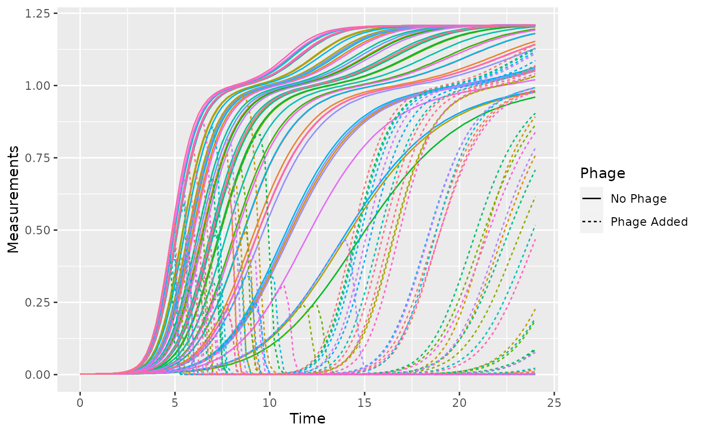
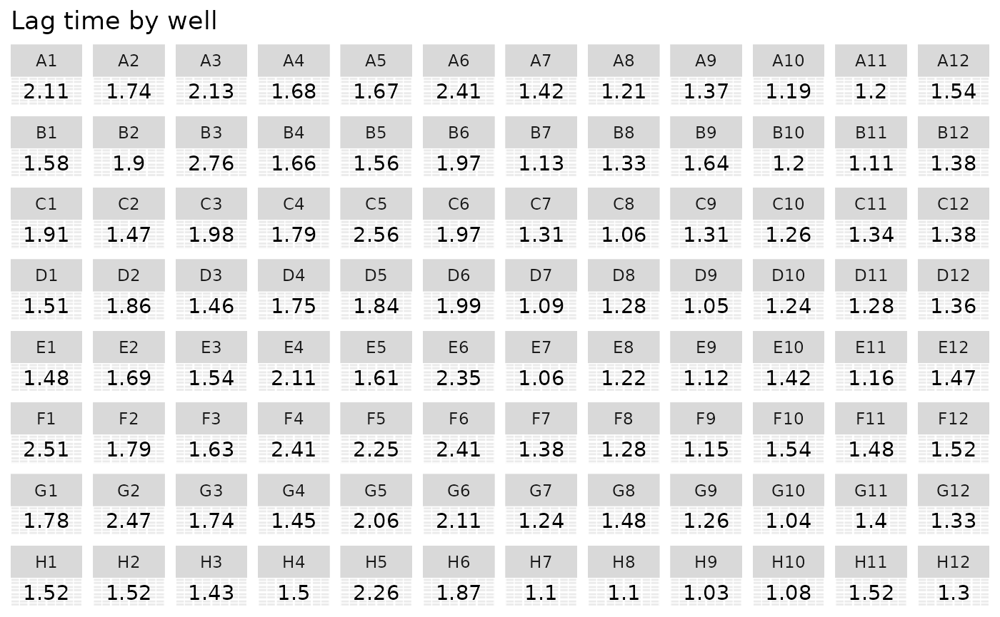
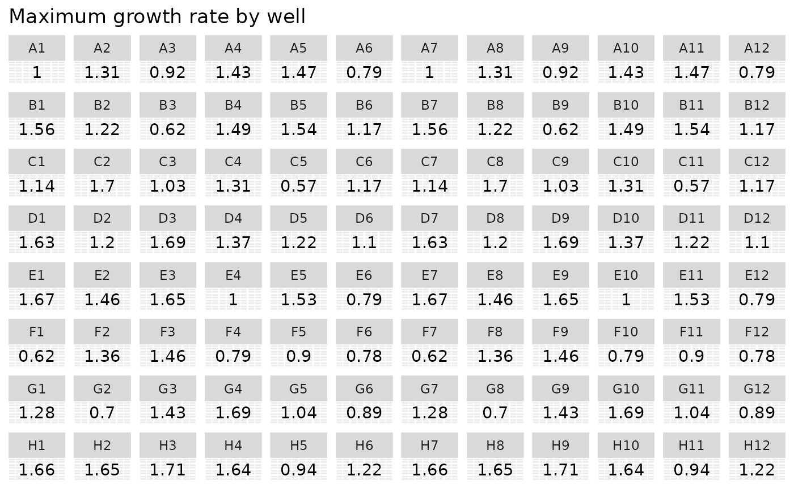
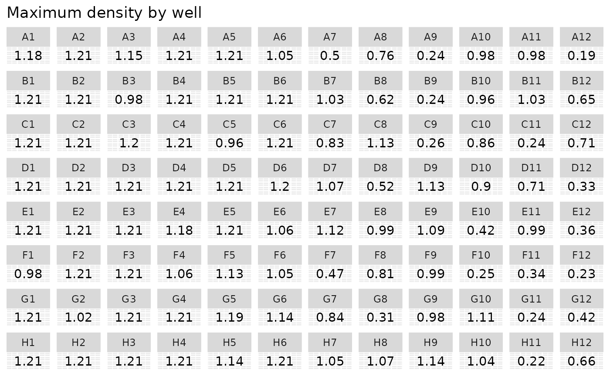
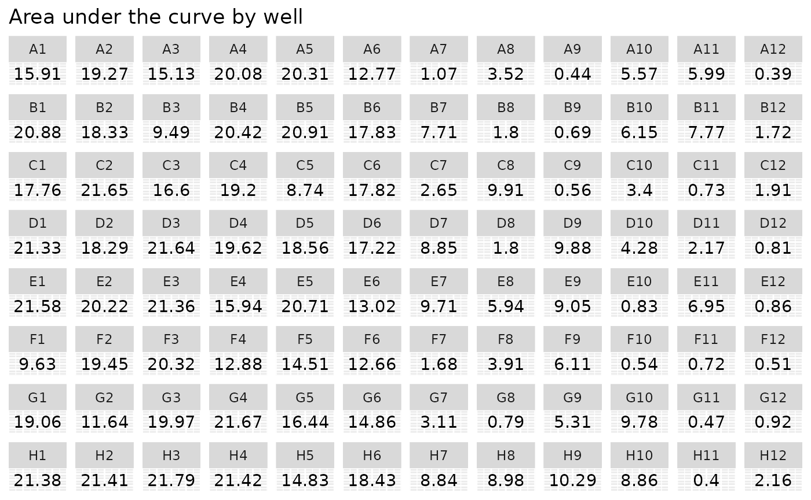

# Introduction to using gcplyr

## Getting started

`gcplyr` is a package that implements a number of functions to make it
easier to import, manipulate, and analyze microbial growth from data
collected in multiwell plate readers (“growth curves”). Without
`gcplyr`, importing and analyzing plate reader data can be a complicated
process that has to be tailored for each experiment, requiring many
lines of code. With `gcplyr` many of those steps are now just a single
line of code.

This document gives an introduction of how to use `gcplyr` for each step
of a growth curve analysis.

To get started, you need your growth curve data file saved to your
computer (.csv, .xls, .xlsx, or any other format that can be read by
`read.table`).

Users often want to combine their data with some information on the
experimental design of their plate(s). You can save this information
into a tabular file as well, or you can just keep it handy to enter
directly in `R` (see
[`vignette("gc03_incorporate_designs")`](https://mikeblazanin.github.io/gcplyr/articles/gc03_incorporate_designs.md)).

Let’s get started by loading `gcplyr`. We’re also going to load a couple
other packages we’ll need.

``` r

library(gcplyr)
#> ## 
#> ## gcplyr (Version 1.13.1, Build Date: 2026-10-16)
#> ## See http://github.com/mikeblazanin/gcplyr for additional documentation
#> ## Please cite software as:
#> ##   Blazanin, Michael. gcplyr: an R package for microbial growth
#> ##   curve data analysis. BMC Bioinformatics 25, 232 (2024).
#> ##   https://doi.org/10.1186/s12859-024-05817-3
#> ##

library(dplyr)
#> 
#> Attaching package: 'dplyr'
#> The following objects are masked from 'package:stats':
#> 
#>     filter, lag
#> The following objects are masked from 'package:base':
#> 
#>     intersect, setdiff, setequal, union
library(ggplot2)
```

## A quick demo of `gcplyr`

Before digging into the details, here’s a simple demonstration of what a
final `gcplyr` script can look like. This script:

1.  imports data from files created by a plate reader
2.  combines it with design files created by the user
3.  calculates the lag time, maximum growth rate, maximum density, and
    area-under-the-curve

**Don’t worry about understanding all the details of how the code works
right now.** Each of these steps is explained in depth in later
articles.

``` r

#For the purposes of this demo, we have to create our example data and
# design files. Normally, the data file would be created by a plate reader, and
# the design file would be created by you, the user

#Generate our example data file, widedata.csv
make_example(vignette = 1, example = 1)
#> Files have been written
#> [1] "./widedata.csv"

#Generate our example design files, Bacteria_strain.csv and Phage.csv
make_example(vignette = 1, example = 2)
#> Files have been written
#> [1] "./Bacteria_strain.csv" "./Phage.csv"

# Read in our data 
data_wide <- read_wides(files = "widedata.csv")

# Transform our data to be tidy-shaped
data_tidy <- 
  trans_wide_to_tidy(wides = data_wide, id_cols = c("file", "Time"))

# Convert our time into hours
data_tidy$Time <- as.numeric(data_tidy$Time)/3600

# Import our designs
designs <- import_blockdesigns(files = c("Bacteria_strain.csv", "Phage.csv"))
#> Inferred 'into' column names as: Bacteria_strain, Phage

# Merge our designs and data
data_merged <- merge_dfs(data_tidy, designs)
#> Joining with `by = join_by(Well)`

#Set up the Well column so they plot in the correct order
data_merged$Well <- 
  factor(data_merged$Well,
         levels = paste0(rep(LETTERS[1:8], each = 12), 1:12))

#Plot the data
ggplot(data = data_merged, aes(x = Time, y = Measurements)) +
  geom_line() +
  facet_wrap(~Well, nrow = 8, ncol = 12)
```



``` r


# Voila! 8 lines of code and all your data is imported & plotted!

# Calculate the per-capita growth rate over time in each well
data_merged <- mutate(
  group_by(data_merged, Well),
  percap_deriv = calc_deriv(y = Measurements, x = Time, percapita = TRUE, 
                            blank = 0, window_width_n = 5))

# Calculate four common metrics of bacterial growth:
#  the lag time, saving it to a column named lag_time
#  the maximum growth rate, saving it to a column named max_percap
#  the maximum density, saving it to a column named max_dens
#  the area-under-the-curve, saving it to a column named 'auc'
data_sum <- summarize(
  group_by(data_merged, Well, Bacteria_strain, Phage),
  lag_time = lag_time(x = Time, y = Measurements, deriv = percap_deriv,
                      blank = 0),
  max_percap = max(percap_deriv, na.rm = TRUE),
  max_dens = max(Measurements),
  auc = auc(y = Measurements, x = Time))
#> `summarise()` has regrouped the output.
#> ℹ Summaries were computed grouped by Well, Bacteria_strain, and Phage.
#> ℹ Output is grouped by Well and Bacteria_strain.
#> ℹ Use `summarise(.groups = "drop_last")` to silence this message.
#> ℹ Use `summarise(.by = c(Well, Bacteria_strain, Phage))` for per-operation
#>   grouping (`?dplyr::dplyr_by`) instead.

# Print some of the values
head(data_sum)
#> # A tibble: 6 × 7
#> # Groups:   Well, Bacteria_strain [6]
#>   Well  Bacteria_strain Phage    lag_time max_percap max_dens   auc
#>   <fct> <chr>           <chr>       <dbl>      <dbl>    <dbl> <dbl>
#> 1 A1    Strain 1        No Phage     2.11      1.00      1.18  15.9
#> 2 A2    Strain 2        No Phage     1.74      1.31      1.21  19.3
#> 3 A3    Strain 3        No Phage     2.13      0.915     1.15  15.1
#> 4 A4    Strain 4        No Phage     1.68      1.43      1.21  20.1
#> 5 A5    Strain 5        No Phage     1.67      1.47      1.21  20.3
#> 6 A6    Strain 6        No Phage     2.41      0.789     1.05  12.8

#Set up the Well column so they plot in the correct order
data_sum$Well <- factor(data_sum$Well, 
                        levels = paste0(rep(LETTERS[1:8], each = 12), 1:12))

#Plot lag time
ggplot(data = data_sum) +
  geom_text(aes(label = round(lag_time, 2), x = 1, y = 1)) +
  facet_wrap(~ Well, ncol = 12) +
  labs(title = "Lag time by well") +
  theme(axis.title = element_blank(), 
        axis.text = element_blank(),
        axis.ticks = element_blank())
```



``` r

#Plot growth rate
ggplot(data = data_sum) +
  geom_text(aes(label = round(max_percap, 2), x = 1, y = 1)) +
  facet_wrap(~ Well, ncol = 12) +
  labs(title = "Maximum growth rate by well") +
  theme(axis.title = element_blank(), 
        axis.text = element_blank(),
        axis.ticks = element_blank())
```



``` r

#Plot Maximum density
ggplot(data = data_sum) +
  geom_text(aes(label = round(max_dens, 2), x = 1, y = 1)) +
  facet_wrap(~ Well, ncol = 12) +
  labs(title = "Maximum density by well") +
  theme(axis.title = element_blank(), 
        axis.text = element_blank(),
        axis.ticks = element_blank())
```



``` r

#Plot AUC
ggplot(data = data_sum) +
  geom_text(aes(label = round(auc, 2), x = 1, y = 1)) +
  facet_wrap(~ Well, ncol = 12) +
  labs(title = "Area under the curve by well") +
  theme(axis.title = element_blank(), 
        axis.text = element_blank(),
        axis.ticks = element_blank())
```



## What’s next?

In the example here, we’ve shown how each step of a `gcplyr` workflow is
only one or a few lines of code. In the following pages, we’ve explained
each of these steps in depth. To start, we’ll learn how to import our
data into `R` and transform it into a convenient format.

1.  Introduction:
    [`vignette("gc01_gcplyr")`](https://mikeblazanin.github.io/gcplyr/articles/gc01_gcplyr.md)
2.  **Importing and reshaping data:
    [`vignette("gc02_import_reshape")`](https://mikeblazanin.github.io/gcplyr/articles/gc02_import_reshape.md)**
3.  Incorporating experimental designs:
    [`vignette("gc03_incorporate_designs")`](https://mikeblazanin.github.io/gcplyr/articles/gc03_incorporate_designs.md)
4.  Pre-processing and plotting your data:
    [`vignette("gc04_preprocess_plot")`](https://mikeblazanin.github.io/gcplyr/articles/gc04_preprocess_plot.md)
5.  Processing your data:
    [`vignette("gc05_process")`](https://mikeblazanin.github.io/gcplyr/articles/gc05_process.md)
6.  Analyzing your data:
    [`vignette("gc06_analyze")`](https://mikeblazanin.github.io/gcplyr/articles/gc06_analyze.md)
7.  Dealing with noise:
    [`vignette("gc07_noise")`](https://mikeblazanin.github.io/gcplyr/articles/gc07_noise.md)
8.  Best practices and other tips:
    [`vignette("gc08_conclusion")`](https://mikeblazanin.github.io/gcplyr/articles/gc08_conclusion.md)
9.  Working with multiple plates:
    [`vignette("gc09_multiple_plates")`](https://mikeblazanin.github.io/gcplyr/articles/gc09_multiple_plates.md)
10. Using make_design to generate experimental designs:
    [`vignette("gc10_using_make_design")`](https://mikeblazanin.github.io/gcplyr/articles/gc10_using_make_design.md)
