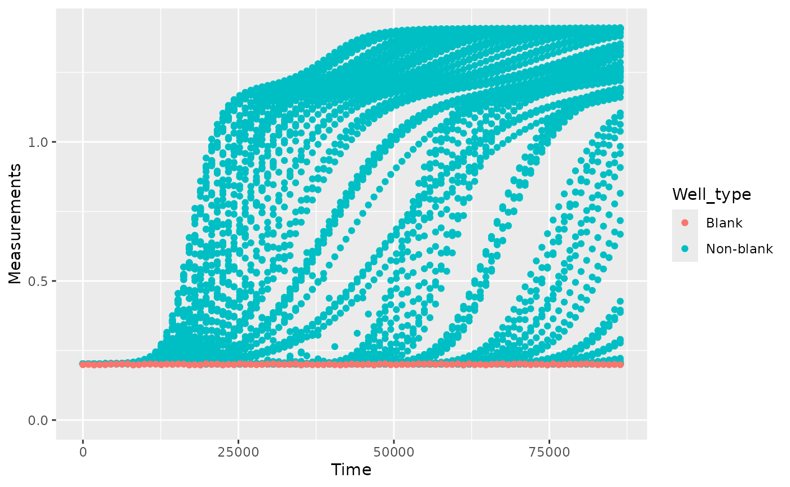
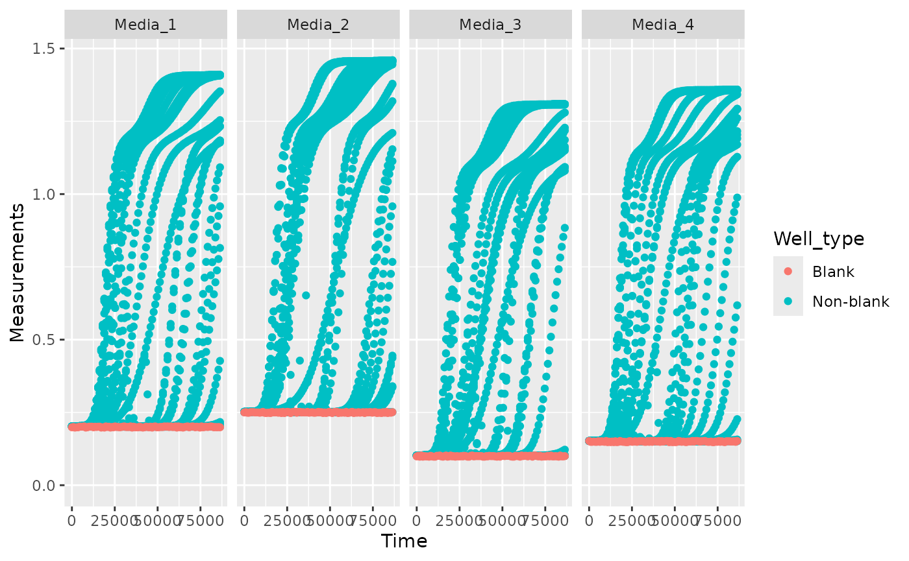
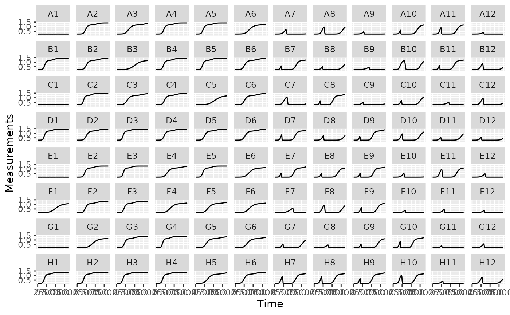

# Pre-processing and plotting data

## Where are we so far?

1.  Introduction:
    [`vignette("gc01_gcplyr")`](https://mikeblazanin.github.io/gcplyr/articles/gc01_gcplyr.md)
2.  Importing and reshaping data:
    [`vignette("gc02_import_reshape")`](https://mikeblazanin.github.io/gcplyr/articles/gc02_import_reshape.md)
3.  Incorporating experimental designs:
    [`vignette("gc03_incorporate_designs")`](https://mikeblazanin.github.io/gcplyr/articles/gc03_incorporate_designs.md)
4.  **Pre-processing and plotting your data:**
    [`vignette("gc04_preprocess_plot")`](https://mikeblazanin.github.io/gcplyr/articles/gc04_preprocess_plot.md)
5.  Processing your data:
    [`vignette("gc05_process")`](https://mikeblazanin.github.io/gcplyr/articles/gc05_process.md)
6.  Analyzing your data:
    [`vignette("gc06_analyze")`](https://mikeblazanin.github.io/gcplyr/articles/gc06_analyze.md)
7.  Dealing with noise:
    [`vignette("gc07_noise")`](https://mikeblazanin.github.io/gcplyr/articles/gc07_noise.md)
8.  Best practices and other tips:
    [`vignette("gc08_conclusion")`](https://mikeblazanin.github.io/gcplyr/articles/gc08_conclusion.md)
9.  Working with multiple plates:
    [`vignette("gc09_multiple_plates")`](https://mikeblazanin.github.io/gcplyr/articles/gc09_multiple_plates.md)
10. Using make_design to generate experimental designs:
    [`vignette("gc10_using_make_design")`](https://mikeblazanin.github.io/gcplyr/articles/gc10_using_make_design.md)

So far, we’ve imported and transformed our measures, then combined them
with our design information. Now we’re going to do some final
pre-processing steps and show how to easily plot our data with `ggplot`.

If you haven’t already, load the necessary packages.

``` r

library(gcplyr)
#> ## 
#> ## gcplyr (Version 1.13.1, Build Date: 2026-10-16)
#> ## See http://github.com/mikeblazanin/gcplyr for additional documentation
#> ## Please cite software as:
#> ##   Blazanin, Michael. gcplyr: an R package for microbial growth
#> ##   curve data analysis. BMC Bioinformatics 25, 232 (2024).
#> ##   https://doi.org/10.1186/s12859-024-05817-3
#> ##

library(dplyr)
#> 
#> Attaching package: 'dplyr'
#> The following objects are masked from 'package:stats':
#> 
#>     filter, lag
#> The following objects are masked from 'package:base':
#> 
#>     intersect, setdiff, setequal, union
library(ggplot2)
library(lubridate)
#> 
#> Attaching package: 'lubridate'
#> The following objects are masked from 'package:base':
#> 
#>     date, intersect, setdiff, union
```

``` r

# This code was previously explained
# Here we're re-running it so it's available for us to work with
example_tidydata <- trans_wide_to_tidy(example_widedata_noiseless,
                                       id_cols = "Time")
ex_dat_mrg <- merge_dfs(example_tidydata, example_design_tidy)
#> Joining with `by = join_by(Well)`
```

## Pre-processing

Now that we have our data and designs merged, we’re almost ready to
start processing and analyzing them. However, first we need to carry out
any necessary pre-processing steps, like excluding wells that were
contaminated or empty, converting time formats to numeric, and
subtracting blanks.

### Pre-processing: excluding data

In some cases, we want to remove some of the wells from our growth
curves data before we carry on with downstream analyses. For instance,
they may have been left empty, contained negative controls, or were
contaminated. We can use `dplyr`’s `filter` function to remove those
wells that meet criteria we want to exclude.

For instance, let’s imagine that we realized that we put the wrong media
into Well B1, and that strain 13 was contaminated. To exclude them from
our analyses, we can simply:

``` r

example_data_and_designs_filtered <- 
  dplyr::filter(ex_dat_mrg, 
         Well != "B1", Bacteria_strain != "Strain 13")
head(example_data_and_designs_filtered)
#>   Time Well Measurements Bacteria_strain    Phage
#> 1    0   A1        0.002        Strain 1 No Phage
#> 2    0   D1        0.002       Strain 19 No Phage
#> 3    0   E1        0.002       Strain 25 No Phage
#> 4    0   F1        0.002       Strain 31 No Phage
#> 5    0   G1        0.002       Strain 37 No Phage
#> 6    0   H1        0.002       Strain 43 No Phage
```

### Pre-processing: converting dates & times into numeric

Growth curve data produced by a plate reader encodes timestamp
information in a variety of ways.

**If your timestamp data is already a nicely-formatted number**
(e.g. number of seconds since the growth curve began), you just need to
make it’s stored in R as a `numeric` type:

``` r

ex_dat_mrg <- make_example(vignette = 4, example = 1)
head(ex_dat_mrg$Time)
#> [1] "0" "0" "0" "0" "0" "0"
class(ex_dat_mrg$Time)
#> [1] "character"
```

Our `Time` column is currently stored as a `character`. That could be a
problem later when we’re analyzing and plotting our data, so let’s
convert it to `numeric`:

``` r

ex_dat_mrg$Time <- as.numeric(ex_dat_mrg$Time)
head(ex_dat_mrg$Time)
#> [1] 0 0 0 0 0 0
```

**Alternatively, timestamp information produced by a plate reader is
often encoded as a string** (e.g. “2:45:11” for 2 hours, 45 minutes, and
11 seconds). For downstream analyses, we need to convert this timestamp
information into a numeric (e.g. number of seconds elapsed). Luckily,
others have written great packages that make it easy to convert from
common date-time text formats into plain numeric formats. Here, we’ll
see how to use `lubridate` to do so:

First we have to create a data frame with time saved as it might be by a
plate reader.

``` r

ex_dat_mrg <- make_example(vignette = 4, example = 2)

head(ex_dat_mrg)
#>      Time Well Measurements Bacteria_strain    Phage
#> 1 0:00:00   A1        0.002        Strain 1 No Phage
#> 2 0:00:00   B1        0.002        Strain 7 No Phage
#> 3 0:00:00   C1        0.002       Strain 13 No Phage
#> 4 0:00:00   D1        0.002       Strain 19 No Phage
#> 5 0:00:00   E1        0.002       Strain 25 No Phage
#> 6 0:00:00   F1        0.002       Strain 31 No Phage
```

We can see that our `Time` aren’t written in an easy numeric. Instead,
they’re in a format that’s easy for a human to understand (but
unfortunately not very usable for analysis).

Let’s use `lubridate` to convert this text into a usable format.
`lubridate` has a whole family of functions that can parse text with
hour, minute, and/or second components. You can use `hms` if your text
contains hour, minute, and second information, `hm` if it only contains
hour and minute information, and `ms` if it only contains minute and
second information.

Once `hms` has parsed the text, we’ll use `time_length` to convert the
output of `hms` into a pure numeric value. By default, `time_length`
returns in units of seconds, but you can change that by changing the
`unit` argument to `time_length`.

``` r

# We have previously loaded lubridate, but if you haven't already then
# make sure to add the line:
#    library(lubridate)

ex_dat_mrg$Time <- time_length(hms(ex_dat_mrg$Time), unit = "hour")

head(ex_dat_mrg)
#>   Time Well Measurements Bacteria_strain    Phage
#> 1    0   A1        0.002        Strain 1 No Phage
#> 2    0   B1        0.002        Strain 7 No Phage
#> 3    0   C1        0.002       Strain 13 No Phage
#> 4    0   D1        0.002       Strain 19 No Phage
#> 5    0   E1        0.002       Strain 25 No Phage
#> 6    0   F1        0.002       Strain 31 No Phage
```

And now we can see that we’ve gotten nice numeric `Time` values!

### Pre-processing: subtracting blanks

Many growth curves are collected by measuring the absorbance or optical
density of a culture. However, with such data an absorbance value of 0
is not equal to a cell density of 0, since components of the media often
absorb some light. It’s best practice to have at least one ‘blank’ well
in your plate containing only media and no cells, so that you can
subtract out this difference from your data so that the values you are
working with are scaled correctly.

Here we have some data including a blank well. The first thing you
should always do is plot your blank wells data to ensure they look
correct:

``` r

ex_dat_mrg <- make_example(vignette = 4, example = 3)
ggplot(data = ex_dat_mrg,
       aes(x = Time, y = Measurements, color = Well_type)) +
  geom_point() +
  ylim(0, NA)
```



Once you’ve confirmed your blank wells weren’t contaminated, one simple
way to subtract blanks is to calculate the average value of your blank
well(s) across all timepoints and subtract that from your
`Measurements`:

``` r

mean_blank <- mean(dplyr::filter(ex_dat_mrg, Well_type == "Blank")$Measurements)
mean_blank
#> [1] 0.2000928
ex_dat_mrg$Meas_norm <- ex_dat_mrg$Measurements - mean_blank
```

Note that if you have different blanks for different wells (e.g. you
have multiple medias), you’ll have to calculate different blank values
for each
\[[`vignette("gc06_analyze")`](https://mikeblazanin.github.io/gcplyr/articles/gc06_analyze.md)
has a primer on the `summarize` function used here, if you’d like to
learn more\]:

``` r

ex_dat_mrg <- make_example(vignette = 4, example = 4)
ggplot(data = ex_dat_mrg,
       aes(x = Time, y = Measurements, color = Well_type)) +
  geom_point() +
  facet_grid(~Media)  +
  ylim(0, NA)
```



``` r


blank_data <- dplyr::filter(ex_dat_mrg, Well_type == "Blank")
blank_data <- group_by(blank_data, Media)
ex_dat_sum <- summarize(blank_data,
                        mean_blank = mean(Measurements))
head(ex_dat_sum)
#> # A tibble: 4 × 2
#>   Media   mean_blank
#>   <chr>        <dbl>
#> 1 Media_1     0.200 
#> 2 Media_2     0.250 
#> 3 Media_3     0.0997
#> 4 Media_4     0.150
ex_dat_mrg <- merge_dfs(ex_dat_mrg, ex_dat_sum)
#> Joining with `by = join_by(Media)`
ex_dat_mrg$Meas_norm <- ex_dat_mrg$Measurements - ex_dat_mrg$mean_blank
```

## Plotting your data

Once your data has been merged and times have been converted to numeric,
we can easily plot our data using the `ggplot2` package. That’s because
`ggplot2` was specifically built on the assumption that data would be
tidy-shaped, which ours is! We won’t go into depth on how to use
`ggplot` here, but there are three main commands to the plot below:

- `ggplot` - the ggplot function is where you specify the `data.frame`
  you would like to use and the *aes*thetics of the plot (the x and y
  axes you would like)
- `geom_line` - tells `ggplot` how we would like to plot the data, in
  this case with a line (another common `geom` for time-series data is
  `geom_point`)
- `facet_wrap` - tells `ggplot` to plot each Well in a separate facet

**We’ll be using this format to plot our data throughout the remainder
of this vignette**

``` r

# We have previously loaded ggplot2, but if you haven't already then
# make sure to add the line:
#     library(ggplot2)

# First, we'll reorder the Well levels so they plot in the correct order
ex_dat_mrg$Well <- 
  factor(ex_dat_mrg$Well,
         levels = paste0(rep(LETTERS[1:8], each = 12), 1:12))

ggplot(data = ex_dat_mrg, aes(x = Time, y = Measurements)) +
  geom_line() +
  facet_wrap(~Well, nrow = 8, ncol = 12)
```



Generally speaking, **from here on you should plot your data
frequently**, and in every way you can think of! **After every
processing and analysis step, visualize both the input data and output
data** to understand what the processing and analysis steps are doing
and whether they are the right choices for your particular data (this
vignette will be doing that too!)

## What’s next?

Now that you’ve pre-processed and visualized your data, it’s time to
process (in most cases) and analyze (pretty much always) it!

1.  Introduction:
    [`vignette("gc01_gcplyr")`](https://mikeblazanin.github.io/gcplyr/articles/gc01_gcplyr.md)
2.  Importing and reshaping data:
    [`vignette("gc02_import_reshape")`](https://mikeblazanin.github.io/gcplyr/articles/gc02_import_reshape.md)
3.  Incorporating experimental designs:
    [`vignette("gc03_incorporate_designs")`](https://mikeblazanin.github.io/gcplyr/articles/gc03_incorporate_designs.md)
4.  Pre-processing and plotting your data:
    [`vignette("gc04_preprocess_plot")`](https://mikeblazanin.github.io/gcplyr/articles/gc04_preprocess_plot.md)
5.  **Processing your data:
    [`vignette("gc05_process")`](https://mikeblazanin.github.io/gcplyr/articles/gc05_process.md)**
6.  **Analyzing your data:
    [`vignette("gc06_analyze")`](https://mikeblazanin.github.io/gcplyr/articles/gc06_analyze.md)**
7.  Dealing with noise:
    [`vignette("gc07_noise")`](https://mikeblazanin.github.io/gcplyr/articles/gc07_noise.md)
8.  Best practices and other tips:
    [`vignette("gc08_conclusion")`](https://mikeblazanin.github.io/gcplyr/articles/gc08_conclusion.md)
9.  Working with multiple plates:
    [`vignette("gc09_multiple_plates")`](https://mikeblazanin.github.io/gcplyr/articles/gc09_multiple_plates.md)
10. Using make_design to generate experimental designs:
    [`vignette("gc10_using_make_design")`](https://mikeblazanin.github.io/gcplyr/articles/gc10_using_make_design.md)
