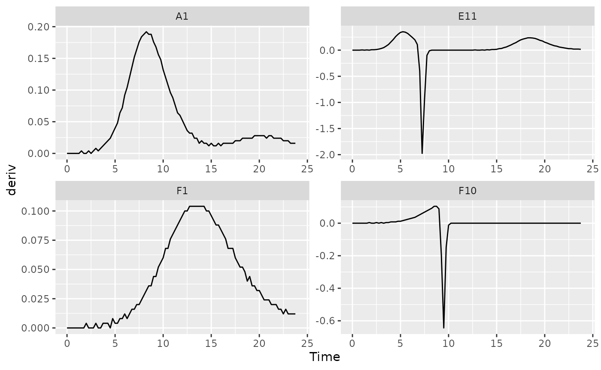
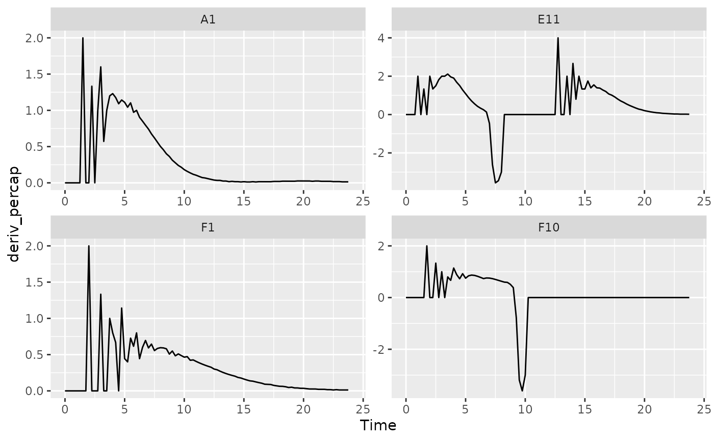
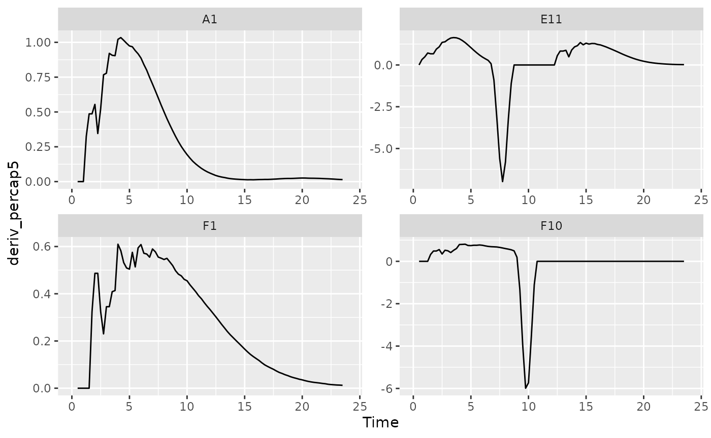

# Processing data

## Where are we so far?

1.  Introduction:
    [`vignette("gc01_gcplyr")`](https://mikeblazanin.github.io/gcplyr/articles/gc01_gcplyr.md)
2.  Importing and reshaping data:
    [`vignette("gc02_import_reshape")`](https://mikeblazanin.github.io/gcplyr/articles/gc02_import_reshape.md)
3.  Incorporating experimental designs:
    [`vignette("gc03_incorporate_designs")`](https://mikeblazanin.github.io/gcplyr/articles/gc03_incorporate_designs.md)
4.  Pre-processing and plotting your data:
    [`vignette("gc04_preprocess_plot")`](https://mikeblazanin.github.io/gcplyr/articles/gc04_preprocess_plot.md)
5.  **Processing your data:**
    [`vignette("gc05_process")`](https://mikeblazanin.github.io/gcplyr/articles/gc05_process.md)
6.  Analyzing your data:
    [`vignette("gc06_analyze")`](https://mikeblazanin.github.io/gcplyr/articles/gc06_analyze.md)
7.  Dealing with noise:
    [`vignette("gc07_noise")`](https://mikeblazanin.github.io/gcplyr/articles/gc07_noise.md)
8.  Best practices and other tips:
    [`vignette("gc08_conclusion")`](https://mikeblazanin.github.io/gcplyr/articles/gc08_conclusion.md)
9.  Working with multiple plates:
    [`vignette("gc09_multiple_plates")`](https://mikeblazanin.github.io/gcplyr/articles/gc09_multiple_plates.md)
10. Using make_design to generate experimental designs:
    [`vignette("gc10_using_make_design")`](https://mikeblazanin.github.io/gcplyr/articles/gc10_using_make_design.md)

So far, we’ve imported and transformed our measures, combined them with
our design information, and pre-processed and plotted our data. Now
we’re going to do some processing of our raw data: calculating
derivatives.

If you haven’t already, load the necessary packages.

``` r

library(gcplyr)
#> ## 
#> ## gcplyr (Version 1.13.0, Build Date: 2026-10-14)
#> ## See http://github.com/mikeblazanin/gcplyr for additional documentation
#> ## Please cite software as:
#> ##   Blazanin, Michael. gcplyr: an R package for microbial growth
#> ##   curve data analysis. BMC Bioinformatics 25, 232 (2024).
#> ##   https://doi.org/10.1186/s12859-024-05817-3
#> ##

library(dplyr)
#> 
#> Attaching package: 'dplyr'
#> The following objects are masked from 'package:stats':
#> 
#>     filter, lag
#> The following objects are masked from 'package:base':
#> 
#>     intersect, setdiff, setequal, union
library(ggplot2)
```

``` r

# This code was previously explained
# Here we're re-running it so it's available for us to work with
example_tidydata <- trans_wide_to_tidy(example_widedata_noiseless,
                                       id_cols = "Time")
ex_dat_mrg <- merge_dfs(example_tidydata, example_design_tidy)
#> Joining with `by = join_by(Well)`
ex_dat_mrg$Well <- 
  factor(ex_dat_mrg$Well,
         levels = paste(rep(LETTERS[1:8], each = 12), 1:12, sep = ""))
#Convert time to hours
ex_dat_mrg$Time <- ex_dat_mrg$Time/3600
```

## How to process and analyze your data

With your data and design information pre-processed, **your dataset is
now organized in a way that’s easy to export and analyze**.

Broadly speaking, there are two main approaches to analyzing growth
curves data:

1.  directly quantify attributes of the growth dynamics (what **gcplyr**
    does)
2.  fit the growth dynamics with a mathematical model, then extract
    parameters from the fitted model (what **other packages** do, see
    [`vignette("gc08_conclusion")`](https://mikeblazanin.github.io/gcplyr/articles/gc08_conclusion.md))

At this point, since the data is now well-organized, advanced users may
also decide they want to write their own custom analyses (in lieu of, or
alongside, `gcplyr`-based and/or fitting-based analyses).

So, how do we directly quantify attributes of growth curves? Generally,
we find features of the density data and its derivatives. Different
projects may desire different analyses, so this article and the
[Analyzing
Data](https://mikeblazanin.github.io/gcplyr/articles/gc06_analyze.md)
and [Dealing with
Noise](https://mikeblazanin.github.io/gcplyr/articles/gc07_noise.md)
articles are written to highlight common analyses, rather than
prescribing what everyone should do.

A number of common metrics (listed below) can’t be quantified from the
density data alone, but instead are calculated involving a derivative of
the density data. If you intend to calculate any of those metrics, or
just want to calculate or plot the derivatives, continue reading.
Otherwise, feel free to skip right to the [Analyzing
Data](https://mikeblazanin.github.io/gcplyr/articles/gc06_analyze.md)
article.

**Metrics requiring a derivative:**

- the lag time
- the time to reach some growth rate
- the maximum per-capita growth rate (i.e. minimum doubling time)
- the inflection point
- the density and time when a diauxic shift occurs
- the maximum per-capita growth rate during diauxie

Before we dig into calculating derivatives, we first need to familiarize
ourselves with the `dplyr` package and its functions `group_by` and
`mutate`. Why? Because the upcoming `gcplyr` processing functions are
*best* used **within**
[`dplyr::mutate`](https://dplyr.tidyverse.org/reference/mutate.html).
**If you’re already familiar with `dplyr`, feel free to skip straight to
[Calculating Derivatives](#CalculatingDerivatives).** If you’re not
familiar yet, the primer will teach you all you need to know to use
`gcplyr`.

### A brief primer on dplyr

The `R` package `dplyr` provides a “grammar of data manipulation” that
is useful for a broad array of data analysis tasks (in fact, `dplyr` is
the direct inspiration for the name of `gcplyr`!) For our purposes,
we’re going to focus on two functions: `group_by` and `mutate`.

The `mutate` function in `dplyr` allows users to easily create new
columns in their `data.frame`’s. For us, we’re going to use `mutate` to
create columns with the derivatives we calculate. However, we want to
make sure that derivative-calculating is done on *each* unique well
independently. In order to do that, we’re first going to use the
`group_by` function, which allows users to group the rows of their
`data.frame`’s into groups that `mutate` will then treat independently.

For growth curves, this means we will:

1.  `group_by` our data so that every unique well is a group
2.  `mutate` to create new columns with our calculated derivatives

For `group_by`, we need to specify the `data.frame` to be grouped, and
then we want to list all the columns needed to identify each unique well
in our dataset. Typically, this includes all of our design columns along
with the plate name and well name. Make sure you’re *not* grouping by
Time, Absorbance, or anything else that varies *within* a well, since if
you do `dplyr` will group timepoints within a well separately.

To use `mutate`, we simply have to specify:

1.  the name of the variable we want results saved to
2.  the function that calculates the new column

If you want additional columns, you simply add them to the `mutate`.

As you’ll see throughout the rest of this article, we’ll be using
`group_by` and `mutate` to calculate derivatives. If you want to learn
more, `dplyr` has extensive documentation and examples of its own
online, but this primer and the coming examples should be sufficient to
calculate derivatives with `gcplyr`.

## Processing data: calculating derivatives

There are two derivatives we might calculate:

- the population growth rate - this is a ‘plain’ derivative, and is
  simply the slope of the original density data at each point in time
- the cellular growth rate - this is a ‘per-capita’ derivative, and is a
  per-cell rate of change of the density at each point in time

Depending on the metrics you’re interested in calculating, you may need
one or both of these derivatives

**If you’re interested in these metrics, you should calculate the plain
derivative:**

- the inflection point
- the density and time when a diauxic shift occurs
- the maximum per-capita growth rate during diauxie

**If you’re interested in these metrics, you should calculate the
per-capita derivative:**

- the lag time
- the time to reach some growth rate
- the maximum per-capita growth rate (i.e. minimum doubling time)

`gcplyr` includes a `calc_deriv` to calculate both the ‘plain’ and
‘per-capita’ derivative.

### A simple derivative

To calculate a plain derivative (the slope of our original data) using
`calc_deriv`, we simply have to provide the x and y values. Note that
this is **not** the growth rate of the cells, but rather is a measure of
how quickly the whole population was changing at each point in time.

``` r

ex_dat_mrg <- mutate(group_by(ex_dat_mrg, Well, Bacteria_strain, Phage),
                     deriv = calc_deriv(x = Time, y = Measurements))
```

To visualize these results, let’s look at a few wells that are
representative of the overall diversity of dynamics in our example data.
(In your own code, you should visualize all your data).

``` r

sample_wells <- c("A1", "F1", "F10", "E11")

# Now let's plot the derivative
ggplot(data = dplyr::filter(ex_dat_mrg, Well %in% sample_wells),
       aes(x = Time, y = deriv)) +
  geom_line() +
  facet_wrap(~Well, scales = "free")
#> Warning: Removed 4 rows containing missing values or values outside the scale range
#> (`geom_line()`).
```



You might notice that these lines aren’t super smooth. Why? The plate
reader data has a limited resolution, only to the nearest 0.001, causing
the derivative to “jump” when the reading increases.

### Per-capita derivative

The per-capita derivative is the slope of our original data divided by
the density at that time. This is a direct measure of how quickly
**each** cell is growing, on average, at each point in time.

To calculate the per-capita derivative, we simply modify our use of
`calc_deriv` with the argument `percapita = TRUE`. Note that in this
case, you are required to specify a blank value, i.e. the value of your
`Measurements` that corresponds to a population density of 0. If your
data have already been normalized, simply add `blank = 0`.

``` r

ex_dat_mrg <- mutate(group_by(ex_dat_mrg, Well, Bacteria_strain, Phage),
                     deriv_percap = calc_deriv(x = Time, y = Measurements,
                                        percapita = TRUE, blank = 0))

# Now let's plot the per-capita derivative
ggplot(data = dplyr::filter(ex_dat_mrg, Well %in% sample_wells),
       aes(x = Time, y = deriv_percap)) +
  geom_line() +
  facet_wrap(~Well, scales = "free")
#> Warning: Removed 4 rows containing missing values or values outside the scale range
#> (`geom_line()`).
```



These derivatives are very jumpy. Why? The same limited resolution of
the plate reader has an amplified effect on the per-capita derivative
when densities are very close to 0. Luckily, `calc_deriv` can calculate
derives by fitting a linear regression to multiple points, reducing this
jumpiness in the derivative.

To use this fitting functionality of `calc_deriv`, specify either the
`window_width` or `window_width_n` parameter. `window_width` specifies
how wide the window used to include points for the fitting is in units
of `x`, while `window_width_n` specifies it in number of data points. I
recommend trying a `window_width_n` of three or five data points, since
that works for most cases.

For best practice, I recommend doing this fitting on log-transformed `y`
values, since exponentially growing density values are linear when
log-transformed. You can achieve this simply by setting
`trans_y = 'log'`. With log-transformation, note that `calc_deriv` will
return `NA` for any data points where the reading is equal to or below
your `blank` value.

``` r

ex_dat_mrg <- mutate(group_by(ex_dat_mrg, Well, Bacteria_strain, Phage),
                     deriv_percap5 = calc_deriv(x = Time, y = Measurements, 
                                        percapita = TRUE, blank = 0,
                                        window_width_n = 5, trans_y = "log"))

# Now let's plot the derivative
ggplot(data = dplyr::filter(ex_dat_mrg, Well %in% sample_wells),
       aes(x = Time, y = deriv_percap5)) +
  geom_line() +
  facet_wrap(~Well, scales = "free")
#> Warning: Removed 16 rows containing missing values or values outside the scale range
#> (`geom_line()`).
```



Great! The jumpiness has been reduced immensely.

### Converting per-capita growth rates into doubling times

If you’d rather express your per-capita growth rates as a doubling time,
simply use the `doubling_time` function to convert your per-capita
growth rates into equivalent doubling times.

``` r

ex_dat_mrg <- mutate(group_by(ex_dat_mrg, Well, Bacteria_strain, Phage),
                     deriv_percap5 = calc_deriv(x = Time, y = Measurements, 
                                        percapita = TRUE, blank = 0,
                                        window_width_n = 5, trans_y = "log"),
                     doub_time = doubling_time(y = deriv_percap5))
head(ex_dat_mrg)
#> # A tibble: 6 × 9
#> # Groups:   Well, Bacteria_strain, Phage [4]
#>    Time Well  Measurements Bacteria_strain Phage       deriv deriv_percap
#>   <dbl> <fct>        <dbl> <chr>           <chr>       <dbl>        <dbl>
#> 1  0    A1           0.002 Strain 1        No Phage        0            0
#> 2  0    F1           0.002 Strain 31       No Phage        0            0
#> 3  0    F10          0.002 Strain 34       Phage Added     0            0
#> 4  0    E11          0.002 Strain 29       Phage Added     0            0
#> 5  0.25 A1           0.002 Strain 1        No Phage        0            0
#> 6  0.25 F1           0.002 Strain 31       No Phage        0            0
#> # ℹ 2 more variables: deriv_percap5 <dbl>, doub_time <dbl>
```

## What’s next?

Now that you’ve processed your data, you’re ready to analyze it!

1.  Introduction:
    [`vignette("gc01_gcplyr")`](https://mikeblazanin.github.io/gcplyr/articles/gc01_gcplyr.md)
2.  Importing and reshaping data:
    [`vignette("gc02_import_reshape")`](https://mikeblazanin.github.io/gcplyr/articles/gc02_import_reshape.md)
3.  Incorporating experimental designs:
    [`vignette("gc03_incorporate_designs")`](https://mikeblazanin.github.io/gcplyr/articles/gc03_incorporate_designs.md)
4.  Pre-processing and plotting your data:
    [`vignette("gc04_preprocess_plot")`](https://mikeblazanin.github.io/gcplyr/articles/gc04_preprocess_plot.md)
5.  Processing your data:
    [`vignette("gc05_process")`](https://mikeblazanin.github.io/gcplyr/articles/gc05_process.md)
6.  **Analyzing your data:
    [`vignette("gc06_analyze")`](https://mikeblazanin.github.io/gcplyr/articles/gc06_analyze.md)**
7.  Dealing with noise:
    [`vignette("gc07_noise")`](https://mikeblazanin.github.io/gcplyr/articles/gc07_noise.md)
8.  Best practices and other tips:
    [`vignette("gc08_conclusion")`](https://mikeblazanin.github.io/gcplyr/articles/gc08_conclusion.md)
9.  Working with multiple plates:
    [`vignette("gc09_multiple_plates")`](https://mikeblazanin.github.io/gcplyr/articles/gc09_multiple_plates.md)
10. Using make_design to generate experimental designs:
    [`vignette("gc10_using_make_design")`](https://mikeblazanin.github.io/gcplyr/articles/gc10_using_make_design.md)
