# Analyzing data

## Where are we so far?

1.  Introduction:
    [`vignette("gc01_gcplyr")`](https://mikeblazanin.github.io/gcplyr/articles/gc01_gcplyr.md)
2.  Importing and reshaping data:
    [`vignette("gc02_import_reshape")`](https://mikeblazanin.github.io/gcplyr/articles/gc02_import_reshape.md)
3.  Incorporating experimental designs:
    [`vignette("gc03_incorporate_designs")`](https://mikeblazanin.github.io/gcplyr/articles/gc03_incorporate_designs.md)
4.  Pre-processing and plotting your data:
    [`vignette("gc04_preprocess_plot")`](https://mikeblazanin.github.io/gcplyr/articles/gc04_preprocess_plot.md)
5.  Processing your data:
    [`vignette("gc05_process")`](https://mikeblazanin.github.io/gcplyr/articles/gc05_process.md)
6.  **Analyzing your data:**
    [`vignette("gc06_analyze")`](https://mikeblazanin.github.io/gcplyr/articles/gc06_analyze.md)
7.  Dealing with noise:
    [`vignette("gc07_noise")`](https://mikeblazanin.github.io/gcplyr/articles/gc07_noise.md)
8.  Best practices and other tips:
    [`vignette("gc08_conclusion")`](https://mikeblazanin.github.io/gcplyr/articles/gc08_conclusion.md)
9.  Working with multiple plates:
    [`vignette("gc09_multiple_plates")`](https://mikeblazanin.github.io/gcplyr/articles/gc09_multiple_plates.md)
10. Using make_design to generate experimental designs:
    [`vignette("gc10_using_make_design")`](https://mikeblazanin.github.io/gcplyr/articles/gc10_using_make_design.md)

So far, we’ve imported and transformed our measures, combined them with
our design information, pre-processed, processed, and plotted our data.
Now we’re going to analyze our data by summarizing our growth curves
into a number of metrics.

If you haven’t already, load the necessary packages.

``` r

library(gcplyr)
#> ## 
#> ## gcplyr (Version 1.13.1, Build Date: 2026-10-16)
#> ## See http://github.com/mikeblazanin/gcplyr for additional documentation
#> ## Please cite software as:
#> ##   Blazanin, Michael. gcplyr: an R package for microbial growth
#> ##   curve data analysis. BMC Bioinformatics 25, 232 (2024).
#> ##   https://doi.org/10.1186/s12859-024-05817-3
#> ##

library(dplyr)
#> 
#> Attaching package: 'dplyr'
#> The following objects are masked from 'package:stats':
#> 
#>     filter, lag
#> The following objects are masked from 'package:base':
#> 
#>     intersect, setdiff, setequal, union
library(ggplot2)
```

``` r

# This code was previously explained
# Here we're re-running it so it's available for us to work with
example_tidydata <- trans_wide_to_tidy(example_widedata_noiseless,
                                       id_cols = "Time")
ex_dat_mrg <- merge_dfs(example_tidydata, example_design_tidy)
#> Joining with `by = join_by(Well)`
ex_dat_mrg$Well <- 
  factor(ex_dat_mrg$Well,
         levels = paste(rep(LETTERS[1:8], each = 12), 1:12, sep = ""))
ex_dat_mrg$Time <- ex_dat_mrg$Time/3600 #Convert time to hours
ex_dat_mrg <-
  mutate(group_by(ex_dat_mrg, Well, Bacteria_strain, Phage),
         deriv = calc_deriv(x = Time, y = Measurements),
         deriv_percap5 = calc_deriv(x = Time, y = Measurements, 
                                        percapita = TRUE, blank = 0,
                                        window_width_n = 5, trans_y = "log"),
         doub_time = doubling_time(y = deriv_percap5))
sample_wells <- c("A1", "F1", "F10", "E11")
# Drop unneeded columns (optional, but makes things cleaner)
ex_dat_mrg <- dplyr::select(ex_dat_mrg,
                            Time, Well, Measurements, Bacteria_strain, Phage,
                            deriv, deriv_percap5)
```

## Analyzing data with summarize

Ultimately, analyzing growth curves requires summarizing the entire time
series of data by some metric or metrics. gcplyr makes it easy to
calculate a number of metrics of interest, which I’ve grouped into
categories:

#### Most common metrics

- [the lag time](#lag)
- [the maximum cellular growth rate (i.e. minimum doubling
  time)](#max_percap)
- [the maximum density (e.g. carrying capacity)](#maxdens)
- [the area under the curve](#auc)

#### Growth

- [the initial density](#init_dens)
- [the lag time](#lag)
- [the time to reach some density](#dens_thresh)
- [the time to reach some growth rate](#percap_thresh)
- [the maximum per-capita growth rate (i.e. minimum doubling
  time)](#max_percap)

#### Saturation

- [the mid-point time or inflection point](#midpoint)
- [the maximum density (e.g. carrying capacity)](#maxdens)

#### Total growth

- [the area under the curve](#auc)
- [the centroid of area under the curve](#centroid)

#### Diauxic growth

- [the density and time when a diauxic shift occurs](#diauxie)
- [the maximum per-capita growth rate during diauxie](#diauxic_percap)

#### Death or growth with antagonists (e.g. phages)

- [the peak bacterial density before a decline (e.g. from phage
  predation)](#peak_dens)
- [the extinction time (e.g. from phage predation)](#extin_time)
- [the area under the curve](#auc)
- [the centroid of area under the curve](#centroid)
- [maximum death rate](#deathrate)
- [total death](#death)

The following sections show how you can use `gcplyr` functions to
calculate these metrics.

But first, we need to familiarize ourselves with one more `dplyr`
function: `summarize`. Why? Because the upcoming `gcplyr` analysis
functions *must* be used *within*
[`dplyr::summarize`](https://dplyr.tidyverse.org/reference/summarise.html).
**If you’re already familiar with `dplyr`’s `summarize`, feel free to
skip the primer in the next section.** If you’re not familiar yet, don’t
worry! Continue to the next section, where I provide a primer that will
teach you all you need to know on using `summarize` with `gcplyr`
functions.

## Another brief primer on dplyr: summarize

Here we’re going to focus on the `summarize` function from `dplyr`,
which *must* be used with the `group_by` function we covered in our
first primer in the Processing Data article
\[[`vignette("gc05_process")`](https://mikeblazanin.github.io/gcplyr/articles/gc05_process.md)\].
`summarize` carries out user-specified calculations on *each* group in a
grouped `data.frame` independently, producing a new `data.frame` where
each group is now just a single row.

For growth curves, this means we will:

1.  `group_by` our data so that every well is a group
2.  `summarize` each well into one or several metrics

As before, to use `group_by` we simply pass the `data.frame` to be
grouped, and the names of the columns we want to group by. Since
`summarize` will drop columns that the data aren’t grouped by and that
aren’t summarized, we will typically want to list all of our design
columns for `group_by`, along with the plate name and well. Again, make
sure you’re *not* grouping by Time, Measurements, or anything else that
varies *within* a well, since if you do `dplyr` will group timepoints
within a well separately.

Then, we run `summarize`. `summarize` works much like `mutate` did,
where we specify:

1.  the name of the variable we want results saved to
2.  the function that calculates the summarized results

Just like `mutate`, if we want additional summary metrics, we simply add
them to the summarize. However, unlike `mutate`, `summarize` functions
return just a single value for each group.

As you’ll see throughout the rest of this article, we’ll be using
`group_by` and `summarize` to calculate our metrics of interest. If you
want to learn more, `dplyr` has extensive documentation and examples of
its own online, but this primer and the coming example should be
sufficient to analyze data with `gcplyr`.

## Plotting summarized metrics

Once you’ve calculated your summarized metrics, you should plot them on
the original data to make sure everything matches what you expect. We
can plot summarized values right on top of our original data:

- density or rate metrics can be plotted as a horizontal line with
  `geom_hline`
- time metrics can be plotted as a vertical line with `geom_vline`
- pairs of metrics that correspond to both density/rate and time can be
  plotted as a point with `geom_point`

You’ll see examples of these plots throughout this article.

## The most common metrics

### Lag time

Bacteria often have a period of time before they reach their maximum
growth rate. If you would like to quantify this lag time, you can use
the `lag_time` function. `lag_time` needs the x and y values, as well as
the (per-capita) derivative and the blank value (the value of your
`Measurements` that corresponds to a population density of 0; if your
data have already been normalized, simply add `blank = 0`). It will find
the maximum derivative, then project the tangent line with that slope
back until it crosses the starting density.

Below, I calculate lag time. So that you can see a visualization of what
this tangent-line calculation does, I also calculate the `max_percap`,
`max_percap_time`, `max_percap_dens`, and `min_dens`, but you don’t have
to do that.

``` r

ex_dat_mrg_sum <- 
  summarize(group_by(ex_dat_mrg, Bacteria_strain, Phage, Well),
            lag_time = lag_time(y = Measurements, x = Time, 
                                deriv = deriv_percap5, blank = 0),
            max_percap = max_gc(deriv_percap5),
            max_percap_time = extr_val(Time, which_max_gc(deriv_percap5)),
            max_percap_dens = extr_val(Measurements, which_max_gc(deriv_percap5)),
            min_dens = min_gc(Measurements))
#> `summarise()` has regrouped the output.
#> ℹ Summaries were computed grouped by Bacteria_strain, Phage, and Well.
#> ℹ Output is grouped by Bacteria_strain and Phage.
#> ℹ Use `summarise(.groups = "drop_last")` to silence this message.
#> ℹ Use `summarise(.by = c(Bacteria_strain, Phage, Well))` for per-operation
#>   grouping (`?dplyr::dplyr_by`) instead.
head(ex_dat_mrg_sum)
#> # A tibble: 6 × 8
#> # Groups:   Bacteria_strain, Phage [6]
#>   Bacteria_strain Phage       Well  lag_time max_percap max_percap_time
#>   <chr>           <chr>       <fct>    <dbl>      <dbl>           <dbl>
#> 1 Strain 1        No Phage    A1        2.18       1.03            4.25
#> 2 Strain 1        Phage Added A7        1.51       1.03            4.25
#> 3 Strain 10       No Phage    B4        1.78       1.59            3.5 
#> 4 Strain 10       Phage Added B10       1.34       1.59            3.5 
#> 5 Strain 11       No Phage    B5        1.67       1.65            3.5 
#> 6 Strain 11       Phage Added B11       1.24       1.65            3.5 
#> # ℹ 2 more variables: max_percap_dens <dbl>, min_dens <dbl>

ggplot(data = dplyr::filter(ex_dat_mrg, Well %in% sample_wells),
       aes(x = Time, y = log(Measurements))) +
  geom_point() +
  facet_wrap(~Well) +
  geom_abline(data = dplyr::filter(ex_dat_mrg_sum, Well %in% sample_wells),
              color = "red",
              aes(slope = max_percap,
                  intercept = log(max_percap_dens) - max_percap*max_percap_time)) +
  geom_vline(data = dplyr::filter(ex_dat_mrg_sum, Well %in% sample_wells),
             aes(xintercept = lag_time), lty = 2) +
  geom_hline(data = dplyr::filter(ex_dat_mrg_sum, Well %in% sample_wells),
             aes(yintercept = log(min_dens)))
```

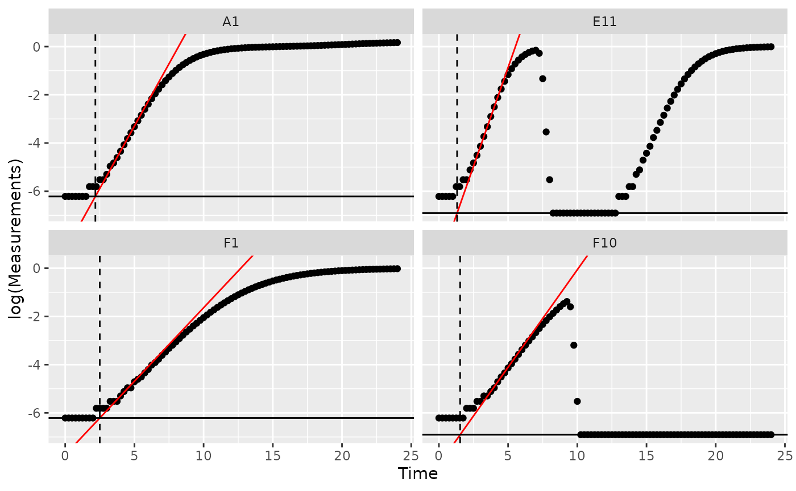

Notice how in some of the wells the minimum density value isn’t the
*initial* density? We can fix that by overriding the default minimum
density calculation with `first_minima` via the `y0` argument of
`lag_time`.

``` r

ex_dat_mrg_sum <- 
  summarize(group_by(ex_dat_mrg, Bacteria_strain, Phage, Well),
            min_dens = first_minima(Measurements, return = "y"),
            lag_time = lag_time(y = Measurements, x = Time, 
                                deriv = deriv_percap5, blank = 0, 
                                y0 = min_dens),
            max_percap = max_gc(deriv_percap5),
            max_percap_time = extr_val(Time, which_max_gc(deriv_percap5)),
            max_percap_dens = extr_val(Measurements, which_max_gc(deriv_percap5)))
#> `summarise()` has regrouped the output.
#> ℹ Summaries were computed grouped by Bacteria_strain, Phage, and Well.
#> ℹ Output is grouped by Bacteria_strain and Phage.
#> ℹ Use `summarise(.groups = "drop_last")` to silence this message.
#> ℹ Use `summarise(.by = c(Bacteria_strain, Phage, Well))` for per-operation
#>   grouping (`?dplyr::dplyr_by`) instead.
head(ex_dat_mrg_sum)
#> # A tibble: 6 × 8
#> # Groups:   Bacteria_strain, Phage [6]
#>   Bacteria_strain Phage       Well  min_dens lag_time max_percap max_percap_time
#>   <chr>           <chr>       <fct>    <dbl>    <dbl>      <dbl>           <dbl>
#> 1 Strain 1        No Phage    A1       0.002     2.18       1.03            4.25
#> 2 Strain 1        Phage Added A7       0.002     2.18       1.03            4.25
#> 3 Strain 10       No Phage    B4       0.002     1.78       1.59            3.5 
#> 4 Strain 10       Phage Added B10      0.002     1.78       1.59            3.5 
#> 5 Strain 11       No Phage    B5       0.002     1.67       1.65            3.5 
#> 6 Strain 11       Phage Added B11      0.002     1.67       1.65            3.5 
#> # ℹ 1 more variable: max_percap_dens <dbl>

ggplot(data = dplyr::filter(ex_dat_mrg, Well %in% sample_wells),
       aes(x = Time, y = log(Measurements))) +
  geom_point() +
  facet_wrap(~Well) +
  geom_abline(data = dplyr::filter(ex_dat_mrg_sum, Well %in% sample_wells),
              color = "red",
              aes(slope = max_percap,
                  intercept = log(max_percap_dens) - max_percap*max_percap_time)) +
  geom_vline(data = dplyr::filter(ex_dat_mrg_sum, Well %in% sample_wells),
             aes(xintercept = lag_time), lty = 2) +
  geom_hline(data = dplyr::filter(ex_dat_mrg_sum, Well %in% sample_wells),
             aes(yintercept = log(min_dens)))
```

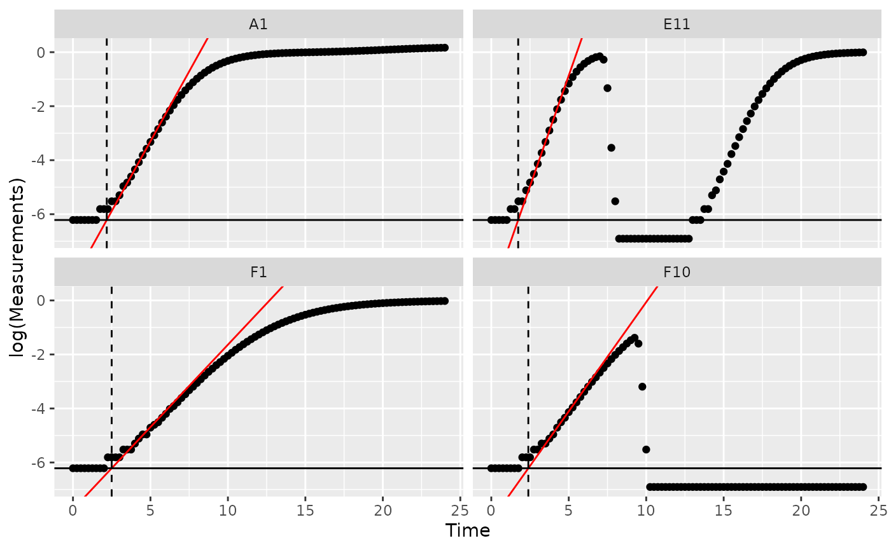

### Maximum growth rate and minimum doubling time

If you want to calculate the bacterial maximum growth rate (i.e. the
minimum doubling time), it will often be sufficient to use `max_gc` on
the per-capita derivatives we calculated in
[`vignette("gc05_process")`](https://mikeblazanin.github.io/gcplyr/articles/gc05_process.md).
(`max_gc` works just like `R`’s built-in `max`, but with better default
settings for growth curve analyses with `summarize`).

We can also save the time when this maximum occurs using the
`which_max_gc` function. `which_max_gc` returns the *index* of the
maximum value, so then we can get the `Time` value at that index and
save it to a column titled `max_percap_time`. (`which_max_gc` and
`extr_val` work just like `R`’s built-in `which.max` and `[`, but with
better default settings for handling `NA` values when doing analyses
within `summarize`)

If you would like the equivalent minimum doubling time, you can simply
calculate the maximum growth rate as above and then convert that into
the equivalent minimum doubling time using the `doubling_time` function.

It is important to note that `gcplyr` calculates the maximum *realized*
growth rate during your growth curve. This is distinct from the
intrinsic growth rate (the maximum *possible* growth rate), although the
two will be quite similar if you started your growth curves at
sufficiently low densities (see: [Ghenu et al., 2024. Challenges and
pitfalls of inferring microbial growth rates from lab cultures.
Frontiers in Ecology and
Evolution.](https://doi.org/10.3389/fevo.2023.1313500))

``` r

ex_dat_mrg_sum <- 
  summarize(group_by(ex_dat_mrg, Bacteria_strain, Phage, Well),
            max_percap = max_gc(deriv_percap5, na.rm = TRUE),
            max_percap_time = extr_val(Time, which_max_gc(deriv_percap5)),
            doub_time = doubling_time(y = max_percap))
#> `summarise()` has regrouped the output.
#> ℹ Summaries were computed grouped by Bacteria_strain, Phage, and Well.
#> ℹ Output is grouped by Bacteria_strain and Phage.
#> ℹ Use `summarise(.groups = "drop_last")` to silence this message.
#> ℹ Use `summarise(.by = c(Bacteria_strain, Phage, Well))` for per-operation
#>   grouping (`?dplyr::dplyr_by`) instead.
head(ex_dat_mrg_sum)
#> # A tibble: 6 × 6
#> # Groups:   Bacteria_strain, Phage [6]
#>   Bacteria_strain Phage       Well  max_percap max_percap_time doub_time
#>   <chr>           <chr>       <fct>      <dbl>           <dbl>     <dbl>
#> 1 Strain 1        No Phage    A1          1.03            4.25     0.670
#> 2 Strain 1        Phage Added A7          1.03            4.25     0.670
#> 3 Strain 10       No Phage    B4          1.59            3.5      0.436
#> 4 Strain 10       Phage Added B10         1.59            3.5      0.436
#> 5 Strain 11       No Phage    B5          1.65            3.5      0.421
#> 6 Strain 11       Phage Added B11         1.65            3.5      0.421

ggplot(data = dplyr::filter(ex_dat_mrg, Well %in% sample_wells),
       aes(x = Time, y = deriv_percap5)) +
  geom_line() +
  facet_wrap(~Well) +
  geom_point(data = dplyr::filter(ex_dat_mrg_sum, Well %in% sample_wells), 
             aes(x = max_percap_time, y = max_percap),
             size = 2, color = "red") +
  coord_cartesian(ylim = c(-1, NA))
#> Warning: Removed 16 rows containing missing values or values outside the scale range
#> (`geom_line()`).
```


### Maximum density

The maximum bacterial density can be a measure of bacterial growth
yield/efficiency. If your bacteria plateau in density, the maximum
density can also be a measure of bacterial carrying capacity. If you
want to quantify the maximum bacterial density, we can use `max_gc` to
get the global maxima of `Measurements` (`max_gc`, `which_max_gc`, and
`extr_val` work just like `R`’s built-in `max`, `which.max`, and `[`,
but with better default settings for handling `NA` values when doing
analyses within `summarize`)

See [Peak bacterial density](#peak_dens) for identifying *local* maxima
of `Measurements` (e.g. if you wanted the first peak in Well E11 shown
below).

``` r

ex_dat_mrg_sum <- 
  summarize(group_by(ex_dat_mrg, Bacteria_strain, Phage, Well),
            max_dens = max_gc(Measurements),
            max_time = extr_val(Time, which_max_gc(Measurements)))
#> `summarise()` has regrouped the output.
#> ℹ Summaries were computed grouped by Bacteria_strain, Phage, and Well.
#> ℹ Output is grouped by Bacteria_strain and Phage.
#> ℹ Use `summarise(.groups = "drop_last")` to silence this message.
#> ℹ Use `summarise(.by = c(Bacteria_strain, Phage, Well))` for per-operation
#>   grouping (`?dplyr::dplyr_by`) instead.
head(ex_dat_mrg_sum)
#> # A tibble: 6 × 5
#> # Groups:   Bacteria_strain, Phage [6]
#>   Bacteria_strain Phage       Well  max_dens max_time
#>   <chr>           <chr>       <fct>    <dbl>    <dbl>
#> 1 Strain 1        No Phage    A1       1.18     24   
#> 2 Strain 1        Phage Added A7       0.499     8.75
#> 3 Strain 10       No Phage    B4       1.21     23.8 
#> 4 Strain 10       Phage Added B10      0.962     8.5 
#> 5 Strain 11       No Phage    B5       1.21     19.5 
#> 6 Strain 11       Phage Added B11      1.03     24

ggplot(data = dplyr::filter(ex_dat_mrg, Well %in% sample_wells),
       aes(x = Time, y = Measurements)) +
  geom_line() +
  facet_wrap(~Well) +
  geom_point(data = dplyr::filter(ex_dat_mrg_sum, Well %in% sample_wells), 
             aes(x = max_time, y = max_dens),
             size = 2, color = "red")
```

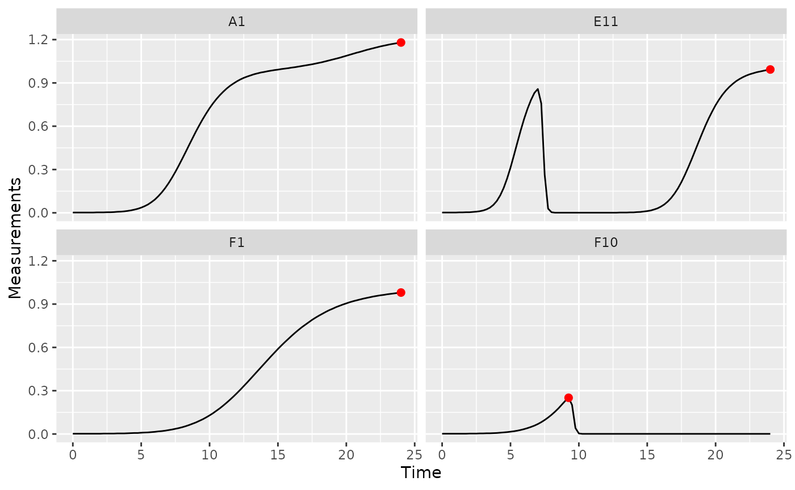

### Area under the curve

The area under the curve is a common metric of total bacterial growth,
for instance in the presence of antagonists like antibiotics or phages.
If you want to calculate the area under the curve, you can use the
`gcplyr` function `auc`. Simply specify Time as the x and Measurements
as the y data whose area-under-the-curve you want to calculate.

``` r

ex_dat_mrg_sum <-
  summarize(group_by(ex_dat_mrg, Bacteria_strain, Phage, Well),
            auc = auc(x = Time, y = Measurements))
#> `summarise()` has regrouped the output.
#> ℹ Summaries were computed grouped by Bacteria_strain, Phage, and Well.
#> ℹ Output is grouped by Bacteria_strain and Phage.
#> ℹ Use `summarise(.groups = "drop_last")` to silence this message.
#> ℹ Use `summarise(.by = c(Bacteria_strain, Phage, Well))` for per-operation
#>   grouping (`?dplyr::dplyr_by`) instead.
head(ex_dat_mrg_sum)
#> # A tibble: 6 × 4
#> # Groups:   Bacteria_strain, Phage [6]
#>   Bacteria_strain Phage       Well    auc
#>   <chr>           <chr>       <fct> <dbl>
#> 1 Strain 1        No Phage    A1    15.9 
#> 2 Strain 1        Phage Added A7     1.07
#> 3 Strain 10       No Phage    B4    20.4 
#> 4 Strain 10       Phage Added B10    6.15
#> 5 Strain 11       No Phage    B5    20.9 
#> 6 Strain 11       Phage Added B11    7.77
```

## Growth metrics

### Initial density

If you want to identify the initial density of your bacteria, it will
often be sufficient to use `min_gc` (this works just like `R`’s built-in
`min`, but with better default settings for growth curve analyses with
`summarize`).

We can also save the time when this minimum occurs using the
`which_min_gc` function. `which_min_gc` returns the *index* of the
minimum value, so then we can get the `Time` value at that index and
save it to a column titled `min_time`. (`which_min_gc` and `extr_val`
work just like `R`’s built-in `which.min` and `[`, but with better
default settings for handling `NA` values when doing analyses within
`summarize`).

``` r

ex_dat_mrg_sum <- 
  summarize(group_by(ex_dat_mrg, Bacteria_strain, Phage, Well),
            min_dens = min_gc(Measurements, na.rm = TRUE),
            min_time = extr_val(Time, which_min_gc(Measurements)))
#> `summarise()` has regrouped the output.
#> ℹ Summaries were computed grouped by Bacteria_strain, Phage, and Well.
#> ℹ Output is grouped by Bacteria_strain and Phage.
#> ℹ Use `summarise(.groups = "drop_last")` to silence this message.
#> ℹ Use `summarise(.by = c(Bacteria_strain, Phage, Well))` for per-operation
#>   grouping (`?dplyr::dplyr_by`) instead.
head(ex_dat_mrg_sum)
#> # A tibble: 6 × 5
#> # Groups:   Bacteria_strain, Phage [6]
#>   Bacteria_strain Phage       Well  min_dens min_time
#>   <chr>           <chr>       <fct>    <dbl>    <dbl>
#> 1 Strain 1        No Phage    A1       0.002     0   
#> 2 Strain 1        Phage Added A7       0.001     9.75
#> 3 Strain 10       No Phage    B4       0.002     0   
#> 4 Strain 10       Phage Added B10      0.001    11   
#> 5 Strain 11       No Phage    B5       0.002     0   
#> 6 Strain 11       Phage Added B11      0.001     6

ggplot(data = dplyr::filter(ex_dat_mrg, Well %in% sample_wells),
       aes(x = Time, y = Measurements)) +
  geom_line() +
  facet_wrap(~Well) +
  geom_point(data = dplyr::filter(ex_dat_mrg_sum, Well %in% sample_wells), 
             aes(x = min_time, y = min_dens),
             size = 2, color = "red")
```

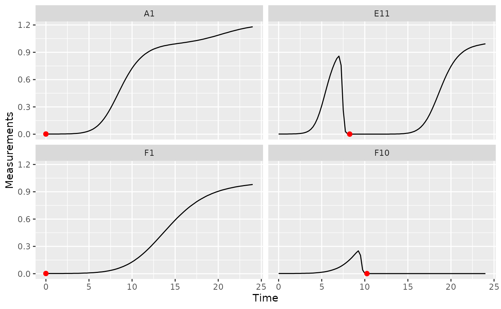

In some cases (e.g. growing with phages), bacteria may later drop to a
lower density than they started in the growth curve. In this case, we
want the first *local* minima of the Measurements data, rather than the
global minima:

``` r

ex_dat_mrg_sum <- 
  summarize(group_by(ex_dat_mrg, Bacteria_strain, Phage, Well),
            min_dens = first_minima(y = Measurements, x = Time, return = "y"),
            min_time = first_minima(y = Measurements, x = Time, return = "x"))
#> `summarise()` has regrouped the output.
#> ℹ Summaries were computed grouped by Bacteria_strain, Phage, and Well.
#> ℹ Output is grouped by Bacteria_strain and Phage.
#> ℹ Use `summarise(.groups = "drop_last")` to silence this message.
#> ℹ Use `summarise(.by = c(Bacteria_strain, Phage, Well))` for per-operation
#>   grouping (`?dplyr::dplyr_by`) instead.
head(ex_dat_mrg_sum)
#> # A tibble: 6 × 5
#> # Groups:   Bacteria_strain, Phage [6]
#>   Bacteria_strain Phage       Well  min_dens min_time
#>   <chr>           <chr>       <fct>    <dbl>    <dbl>
#> 1 Strain 1        No Phage    A1       0.002        0
#> 2 Strain 1        Phage Added A7       0.002        0
#> 3 Strain 10       No Phage    B4       0.002        0
#> 4 Strain 10       Phage Added B10      0.002        0
#> 5 Strain 11       No Phage    B5       0.002        0
#> 6 Strain 11       Phage Added B11      0.002        0
```

Note that you can tune the sensitivity of `first_minima` to different
heights and widths of peaks and valleys using the `window_width`,
`window_width_n`, and `window_height` arguments. You should check that
`first_minima` is working with your data by plotting it, although the
default sensitivity works much of the time.

### Lag time

See [the lag time section in the Most Common Metrics section](#lag)

### Time to reach threshold density

If you want to quantify how long it takes bacteria to reach some
threshold density, you can use the `first_above` function. In this
example, we’ll use a Measurements value of 0.1 as our threshold.

``` r

ex_dat_mrg_sum <- 
  summarize(group_by(ex_dat_mrg, Bacteria_strain, Phage, Well),
            above_01 = first_above(y = Measurements, x = Time, 
                                   threshold = 0.1, return = "x"))
#> `summarise()` has regrouped the output.
#> ℹ Summaries were computed grouped by Bacteria_strain, Phage, and Well.
#> ℹ Output is grouped by Bacteria_strain and Phage.
#> ℹ Use `summarise(.groups = "drop_last")` to silence this message.
#> ℹ Use `summarise(.by = c(Bacteria_strain, Phage, Well))` for per-operation
#>   grouping (`?dplyr::dplyr_by`) instead.
head(ex_dat_mrg_sum)
#> # A tibble: 6 × 4
#> # Groups:   Bacteria_strain, Phage [6]
#>   Bacteria_strain Phage       Well  above_01
#>   <chr>           <chr>       <fct>    <dbl>
#> 1 Strain 1        No Phage    A1        6.09
#> 2 Strain 1        Phage Added A7        6.09
#> 3 Strain 10       No Phage    B4        4.25
#> 4 Strain 10       Phage Added B10       4.25
#> 5 Strain 11       No Phage    B5        4.04
#> 6 Strain 11       Phage Added B11       4.04

ggplot(data = dplyr::filter(ex_dat_mrg, Well %in% sample_wells),
       aes(x = Time, y = Measurements)) +
  geom_line() +
  facet_wrap(~Well) +
  geom_vline(data = dplyr::filter(ex_dat_mrg_sum, Well %in% sample_wells), 
             aes(xintercept = above_01), lty = 2, color = "red")
```

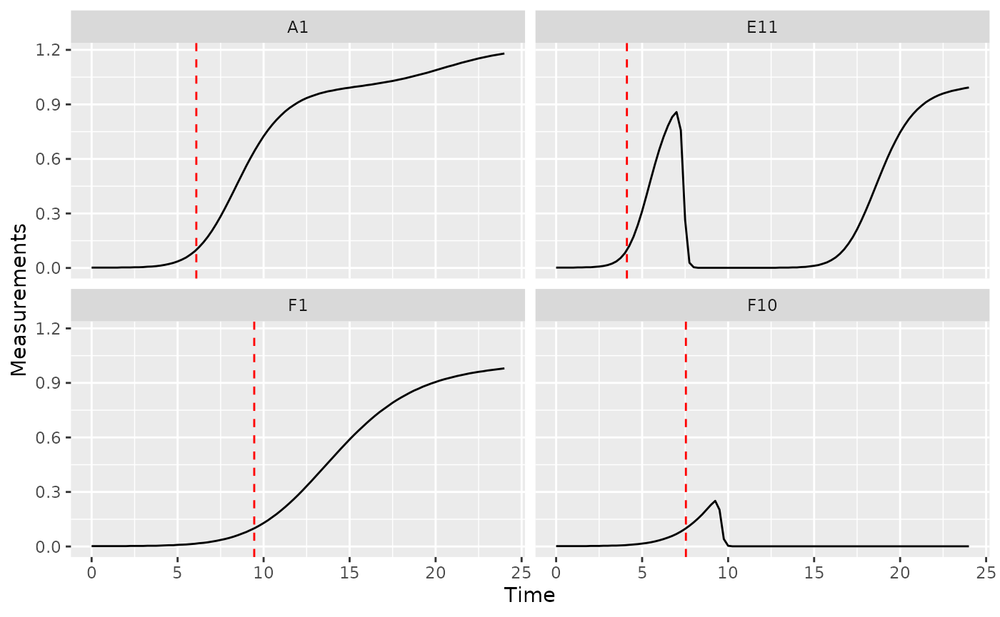

### Time to reach threshold growth rate

If you want to quantify how long it takes bacteria to reach some
threshold per-capita growth rate, you can use the `first_above`
function. In this example, we’ll use a per-capita derivative of 1 as our
threshold.

``` r

ex_dat_mrg_sum <- 
  summarize(group_by(ex_dat_mrg, Bacteria_strain, Phage, Well),
            percap_above_1 = first_above(y = deriv_percap5, x = Time, 
                                   threshold = 1, return = "x"))
#> `summarise()` has regrouped the output.
#> ℹ Summaries were computed grouped by Bacteria_strain, Phage, and Well.
#> ℹ Output is grouped by Bacteria_strain and Phage.
#> ℹ Use `summarise(.groups = "drop_last")` to silence this message.
#> ℹ Use `summarise(.by = c(Bacteria_strain, Phage, Well))` for per-operation
#>   grouping (`?dplyr::dplyr_by`) instead.
head(ex_dat_mrg_sum)
#> # A tibble: 6 × 4
#> # Groups:   Bacteria_strain, Phage [6]
#>   Bacteria_strain Phage       Well  percap_above_1
#>   <chr>           <chr>       <fct>          <dbl>
#> 1 Strain 1        No Phage    A1              3.95
#> 2 Strain 1        Phage Added A7              3.95
#> 3 Strain 10       No Phage    B4              2.28
#> 4 Strain 10       Phage Added B10             2.28
#> 5 Strain 11       No Phage    B5              2.11
#> 6 Strain 11       Phage Added B11             2.11

ggplot(data = dplyr::filter(ex_dat_mrg, Well %in% sample_wells),
       aes(x = Time, y = deriv_percap5)) +
  geom_line() +
  facet_wrap(~Well) +
  geom_vline(data = dplyr::filter(ex_dat_mrg_sum, Well %in% sample_wells),
             aes(xintercept = percap_above_1), lty = 2, color = "red") +
  coord_cartesian(ylim = c(-1, NA))
#> Warning: Removed 16 rows containing missing values or values outside the scale range
#> (`geom_line()`).
#> Warning: Removed 2 rows containing missing values or values outside the scale range
#> (`geom_vline()`).
```

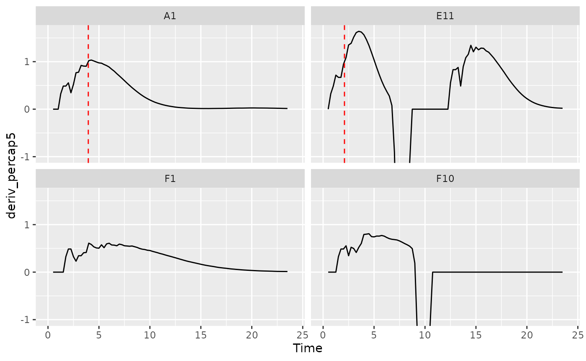

### Maximum growth rate and minimum doubling time

See [the maximum growth rate section in the Most Common Metrics
section](#max_percap)

## Saturation metrics

### Mid-point time or inflection point

If you want to find the mid-point or inflection point of bacterial
growth, there are two different approaches:

1.  Mid-point: find the point when the density first reaches half the
    maximum density.
2.  Inflection point: find the point when the derivative is at a
    maximum.

In growth curve analysis approaches using fitting of a symmetric
function (e.g. when other `R` packages fit a logistic function to data),
these two points will be equivalent. However, since `gcplyr` does
model-free analyses, we do not assume symmetry, and so the points may be
very similar or very different.

For the mid-point, we use the `first_above` function, with the threshold
equal to the maximum bacterial density divided by 2. For the inflection
point, we find the time when the `deriv` was at a maximum using
`which_max_gc` (`which_max_gc` and `extr_val` work just like `R`’s
built-in `which.max` and `[`, but with better default settings for
handling `NA` values when doing analyses within `summarize`).

``` r

ex_dat_mrg_sum <- 
  summarize(group_by(ex_dat_mrg, Bacteria_strain, Phage, Well),
            mid_point = first_above(y = Measurements, x = Time, return = "x",
                                    threshold = max_gc(Measurements)/2),
            infl_point = extr_val(Time, which_max_gc(deriv)))
#> `summarise()` has regrouped the output.
#> ℹ Summaries were computed grouped by Bacteria_strain, Phage, and Well.
#> ℹ Output is grouped by Bacteria_strain and Phage.
#> ℹ Use `summarise(.groups = "drop_last")` to silence this message.
#> ℹ Use `summarise(.by = c(Bacteria_strain, Phage, Well))` for per-operation
#>   grouping (`?dplyr::dplyr_by`) instead.
head(ex_dat_mrg_sum)
#> # A tibble: 6 × 5
#> # Groups:   Bacteria_strain, Phage [6]
#>   Bacteria_strain Phage       Well  mid_point infl_point
#>   <chr>           <chr>       <fct>     <dbl>      <dbl>
#> 1 Strain 1        No Phage    A1         9.15       8.25
#> 2 Strain 1        Phage Added A7         7.29       8.25
#> 3 Strain 10       No Phage    B4         6.06       5.5 
#> 4 Strain 10       Phage Added B10        5.67       5.5 
#> 5 Strain 11       No Phage    B5         5.71       5   
#> 6 Strain 11       Phage Added B11       16.7        5

ggplot(data = dplyr::filter(ex_dat_mrg, Well %in% sample_wells),
       aes(x = Time, y = Measurements)) +
  geom_line() +
  facet_wrap(~Well) +
  geom_vline(data = dplyr::filter(ex_dat_mrg_sum, Well %in% sample_wells),
             aes(xintercept = mid_point), lty = 2, color = "red") +
  geom_vline(data = dplyr::filter(ex_dat_mrg_sum, Well %in% sample_wells),
             aes(xintercept = infl_point), lty = 2, color = "blue")
```

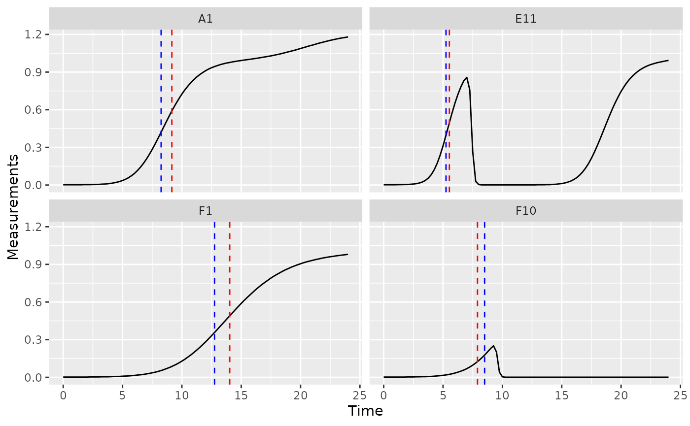

### Maximum density

See [the maximum density section in the Most Common Metrics
section](#maxdens)

## Total growth metrics

### Area under the curve

See [the area under the curve section in the Most Common Metrics
section](#auc)

### Centroid of area under the curve

The centroid, or center of mass, of the area under the curve can
function as a metric of total microbial growth. If the area under the
curve were a solid object, the centroid is the point where that object
would balance perfectly. The centroid has both an x coordinate and a y
coordinate. To calculate the centroid coordinates, you can use the
`gcplyr` function `centroid_x` and `centroid_y`. Simply specify Time as
the x and Measurements as the y data whose centroid you want to
calculate.

``` r

ex_dat_mrg_sum <-
  summarize(group_by(ex_dat_mrg, Bacteria_strain, Phage, Well),
            centr_x = centroid_x(x = Time, y = Measurements),
            centr_y = centroid_y(x = Time, y = Measurements))
#> `summarise()` has regrouped the output.
#> ℹ Summaries were computed grouped by Bacteria_strain, Phage, and Well.
#> ℹ Output is grouped by Bacteria_strain and Phage.
#> ℹ Use `summarise(.groups = "drop_last")` to silence this message.
#> ℹ Use `summarise(.by = c(Bacteria_strain, Phage, Well))` for per-operation
#>   grouping (`?dplyr::dplyr_by`) instead.
head(ex_dat_mrg_sum)
#> # A tibble: 6 × 5
#> # Groups:   Bacteria_strain, Phage [6]
#>   Bacteria_strain Phage       Well  centr_x centr_y
#>   <chr>           <chr>       <fct>   <dbl>   <dbl>
#> 1 Strain 1        No Phage    A1      16.5    0.485
#> 2 Strain 1        Phage Added A7       8.07   0.150
#> 3 Strain 10       No Phage    B4      15.2    0.546
#> 4 Strain 10       Phage Added B10     13.5    0.347
#> 5 Strain 11       No Phage    B5      15.1    0.552
#> 6 Strain 11       Phage Added B11     19.2    0.414

ggplot(data = dplyr::filter(ex_dat_mrg, Well %in% sample_wells),
       aes(x = Time, y = Measurements)) +
  geom_line() +
  facet_wrap(~Well) +
  geom_point(data = dplyr::filter(ex_dat_mrg_sum, Well %in% sample_wells), 
             aes(x = centr_x, y = centr_y))
```

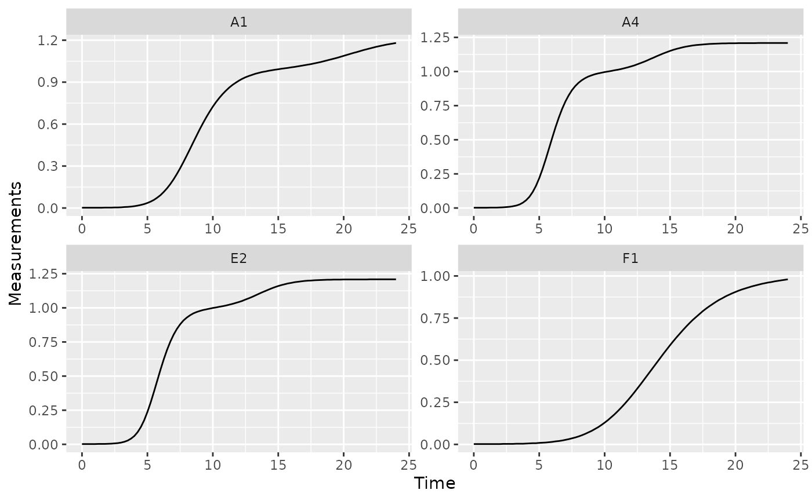

## Diauxic growth metrics

### Diauxic shifts

Bacteria frequently exhibit a second, slower, burst of growth after
their first period of rapid growth. This is common in growth curves and
is called *diauxic growth*.

If we plot the data from some of our example data wells with no phage
added, we’ll see this pattern repeatedly:

``` r

nophage_wells <- c("A1", "A4", "E2", "F1")
ggplot(data = dplyr::filter(ex_dat_mrg, Well %in% nophage_wells),
       aes(x = Time, y = Measurements)) +
  geom_line() +
  facet_wrap(~Well, scales = "free")
```

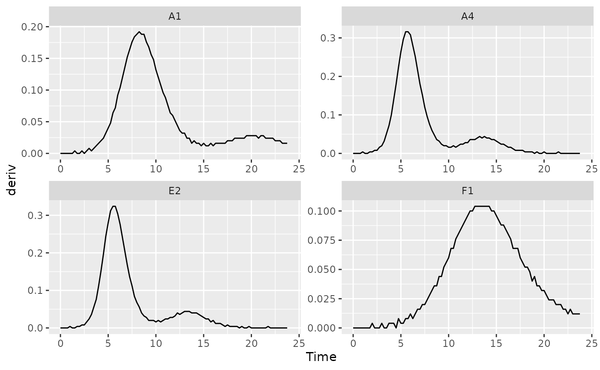

We can identify the time when bacteria switch from their first period of
rapid growth to their second period by finding a minima in the
derivative values. Specifically, we want to identify the second minima
(the first minima will occur at the beginning of the growth curve, when
bacteria are just starting to grow). Let’s look at some of the
derivative values to see this.

``` r

ggplot(data = dplyr::filter(ex_dat_mrg, Well %in% nophage_wells),
       aes(x = Time, y = deriv)) +
  geom_line() +
  facet_wrap(~Well, scales = "free")
#> Warning: Removed 4 rows containing missing values or values outside the scale range
#> (`geom_line()`).
```

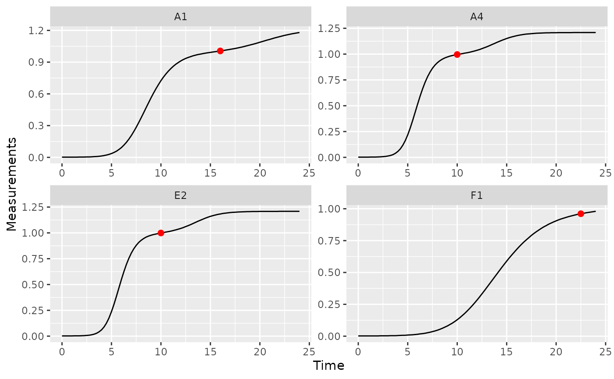

We can use the `gcplyr` function `find_local_extrema` to find that
minima. Specify `deriv` as the y data and `Time` as the x data, and that
we want `find_local_extrema` to `return` the `x` values associated with
local minima. It will return a vector of those `x` values, and we’re
going to save just the second one.

At the same time, we’re also going to save the density where the diauxic
shift occurs. First, we’ll use `find_local_extrema` again, but this time
to save the *index* where the diauxic shift occurs to a column titled
`diauxie_idx`. Then, we can get the `Measurements` value at that index.
(Note that it wouldn’t work to just specify `return = "y"`, because the
`y` values in this case are the `deriv` values). (`extr_val` works just
like `R`’s built-in `[`, but with better default settings for handling
`NA` values when doing analyses within `summarize`).

``` r

ex_dat_mrg_sum <-
  summarize(group_by(ex_dat_mrg, Bacteria_strain, Phage, Well),
    diauxie_idx = find_local_extrema(x = Time, y = deriv, return = "index",
                                   return_maxima = FALSE, return_minima = TRUE,
                                   window_width_n = 39)[2],
    diauxie_time = extr_val(Time, diauxie_idx),
    diauxie_dens = extr_val(Measurements, diauxie_idx))
#> `summarise()` has regrouped the output.
#> ℹ Summaries were computed grouped by Bacteria_strain, Phage, and Well.
#> ℹ Output is grouped by Bacteria_strain and Phage.
#> ℹ Use `summarise(.groups = "drop_last")` to silence this message.
#> ℹ Use `summarise(.by = c(Bacteria_strain, Phage, Well))` for per-operation
#>   grouping (`?dplyr::dplyr_by`) instead.

head(ex_dat_mrg_sum)
#> # A tibble: 6 × 6
#> # Groups:   Bacteria_strain, Phage [6]
#>   Bacteria_strain Phage       Well  diauxie_idx diauxie_time diauxie_dens
#>   <chr>           <chr>       <fct>       <int>        <dbl>        <dbl>
#> 1 Strain 1        No Phage    A1             65        16           1.01 
#> 2 Strain 1        Phage Added A7             37         9           0.379
#> 3 Strain 10       No Phage    B4             40         9.75        0.999
#> 4 Strain 10       Phage Added B10            38         9.25        0.682
#> 5 Strain 11       No Phage    B5             39         9.5         1.01 
#> 6 Strain 11       Phage Added B11            23         5.5         0.346

# Plot data with a point at the moment of diauxic shift
ggplot(data = dplyr::filter(ex_dat_mrg, Well %in% nophage_wells),
       aes(x = Time, y = Measurements)) +
  geom_line() +
  facet_wrap(~Well, scales = "free") +
  geom_point(data = dplyr::filter(ex_dat_mrg_sum, Well %in% nophage_wells), 
             aes(x = diauxie_time, y = diauxie_dens),
             size = 2, color = "red")
```


If needed, you can tune the sensitivity of `find_local_extrema` to
different heights and widths of peaks and valleys using the
`window_width`, `window_width_n`, and `window_height` arguments.

### Growth rate during diauxie

In the previous section we identified when bacteria shifted into their
second period of rapid growth (‘diauxic growth’). If you want to find
out what the peak per-capita growth rate was during that second burst,
we’ll have to use `max` on the subset of data after the diauxic shift
identified by `find_local_extrema`

Just as we did in the previous section, we’ll use `find_local_extrema`
to save the time when the diauxic shift occurs. Then, we’ll find the
maximum of the per-capita derivative after that shift occurs. Finally,
we’ll find the time when that post-diauxie maximum growth rate occurs.
Note that we’re using `max_gc` and `which_max_gc`, which work just like
`R`’s built-in `max` and `which.max`, but with better default settings
for growth curve analyses with `summarize`.

``` r

ex_dat_mrg_sum <-
  summarize(
    group_by(ex_dat_mrg, Bacteria_strain, Phage, Well),
    diauxie_time = 
      find_local_extrema(x = Time, y = deriv, return = "x",
                         return_maxima = FALSE, return_minima = TRUE,
                         window_width_n = 39)[2],
    diauxie_percap_idx = which_max_gc(deriv_percap5[Time >= diauxie_time]),
    diauxie_percap = extr_val(deriv_percap5[Time >= diauxie_time],
                              diauxie_percap_idx),
    diauxie_percap_time = extr_val(Time[Time >= diauxie_time],
                                   diauxie_percap_idx)
  )
#> `summarise()` has regrouped the output.
#> ℹ Summaries were computed grouped by Bacteria_strain, Phage, and Well.
#> ℹ Output is grouped by Bacteria_strain and Phage.
#> ℹ Use `summarise(.groups = "drop_last")` to silence this message.
#> ℹ Use `summarise(.by = c(Bacteria_strain, Phage, Well))` for per-operation
#>   grouping (`?dplyr::dplyr_by`) instead.
head(ex_dat_mrg_sum)
#> # A tibble: 6 × 7
#> # Groups:   Bacteria_strain, Phage [6]
#>   Bacteria_strain Phage     Well  diauxie_time diauxie_percap_idx diauxie_percap
#>   <chr>           <chr>     <fct>        <dbl>              <int>          <dbl>
#> 1 Strain 1        No Phage  A1           16                    17         0.0257
#> 2 Strain 1        Phage Ad… A7            9                    44         0.832 
#> 3 Strain 10       No Phage  B4            9.75                 15         0.0398
#> 4 Strain 10       Phage Ad… B10           9.25                 35         1.24  
#> 5 Strain 11       No Phage  B5            9.5                  12         0.0438
#> 6 Strain 11       Phage Ad… B11           5.5                  30         1.43  
#> # ℹ 1 more variable: diauxie_percap_time <dbl>

# Plot data with a point at the moment of peak diauxic growth rate
ggplot(data = dplyr::filter(ex_dat_mrg, Well %in% nophage_wells),
       aes(x = Time, y = deriv_percap5)) +
  geom_line() +
  facet_wrap(~Well, scales = "free") +
  geom_point(data = dplyr::filter(ex_dat_mrg_sum, Well %in% nophage_wells), 
             aes(x = diauxie_percap_time, y = diauxie_percap),
             size = 2, color = "red")
#> Warning: Removed 16 rows containing missing values or values outside the scale range
#> (`geom_line()`).
```

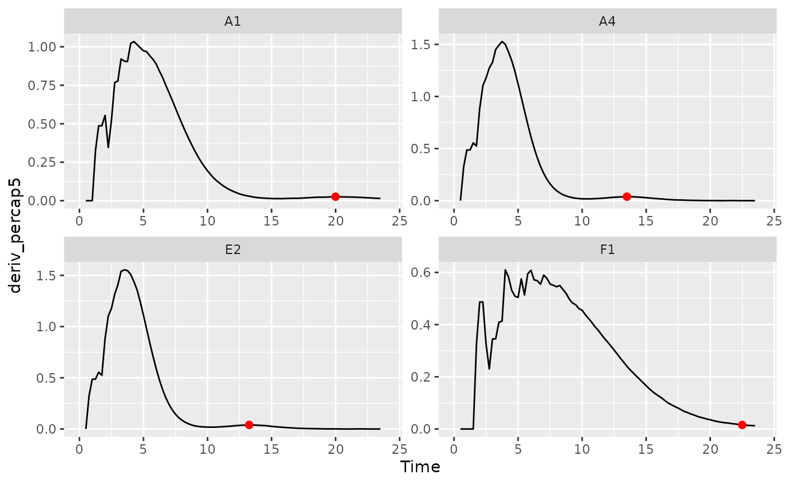

## Metrics of death or growth with antagonists

### Peak bacterial density

[We previously found the global maximum in bacterial density](#maxdens)
using the simple `max_gc` and `which_max_gc` functions. The first
*local* maxima can also be of interest. This is especially true when
bacteria are grown with phages, where their first peak density can act
as a proxy measure for their susceptibility to the phage. If you’re
interested in finding the first local maxima in bacterial density, you
can use the `gcplyr` function `first_maxima`.

`first_maxima` simply requires the `y` data you want to identify the
peak in. Specify `Measurements` as the y data and `Time` as the x data,
and that we want `first_peak` to `return` the `x` and `y` values
associated with the peak. We’ll save those in columns `first_maxima_x`
and `first_maxima_y`, respectively.

``` r

ex_dat_mrg_sum <-
  summarize(group_by(ex_dat_mrg, Bacteria_strain, Phage, Well),
            first_maxima_x = first_maxima(x = Time, y = Measurements, 
                                          return = "x"),
            first_maxima_y = first_maxima(x = Time, y = Measurements, 
                                          return = "y"))
#> `summarise()` has regrouped the output.
#> ℹ Summaries were computed grouped by Bacteria_strain, Phage, and Well.
#> ℹ Output is grouped by Bacteria_strain and Phage.
#> ℹ Use `summarise(.groups = "drop_last")` to silence this message.
#> ℹ Use `summarise(.by = c(Bacteria_strain, Phage, Well))` for per-operation
#>   grouping (`?dplyr::dplyr_by`) instead.
head(ex_dat_mrg_sum)
#> # A tibble: 6 × 5
#> # Groups:   Bacteria_strain, Phage [6]
#>   Bacteria_strain Phage       Well  first_maxima_x first_maxima_y
#>   <chr>           <chr>       <fct>          <dbl>          <dbl>
#> 1 Strain 1        No Phage    A1             24             1.18 
#> 2 Strain 1        Phage Added A7              8.75          0.499
#> 3 Strain 10       No Phage    B4             19.8           1.21 
#> 4 Strain 10       Phage Added B10             8.5           0.962
#> 5 Strain 11       No Phage    B5             19.5           1.21 
#> 6 Strain 11       Phage Added B11             5.25          0.439

ggplot(data = dplyr::filter(ex_dat_mrg, Well %in% sample_wells), 
       aes(x = Time, y = Measurements)) +
  geom_line() +
  facet_wrap(~Well) +
  geom_point(data = dplyr::filter(ex_dat_mrg_sum, Well %in% sample_wells), 
             aes(x = first_maxima_x, y = first_maxima_y), 
             color = "red", size = 1.5)
```

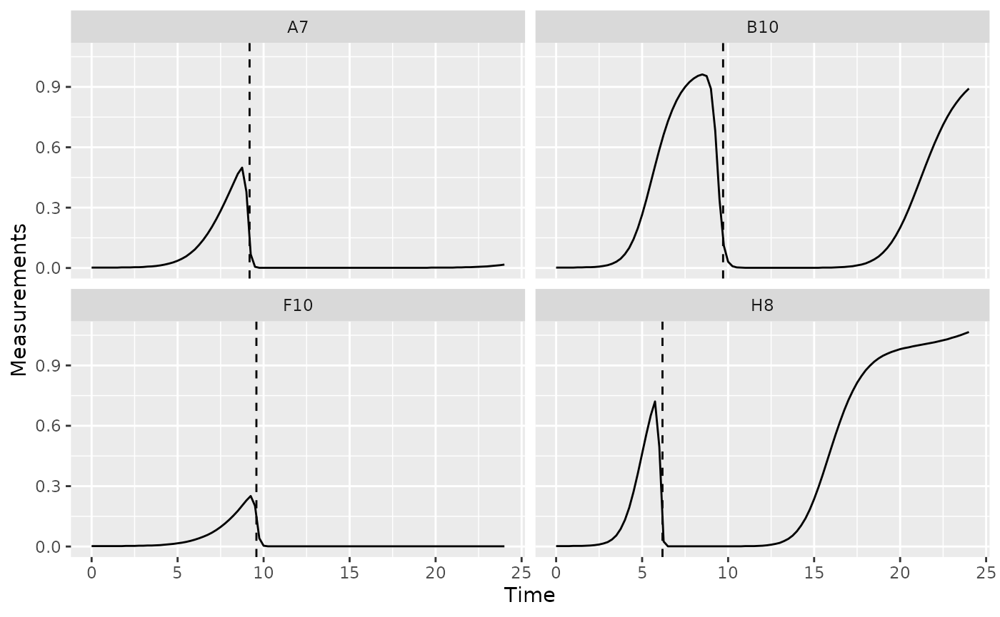

Note that you can tune the sensitivity of `first_maxima` to different
heights and widths of peaks and valleys using the `window_width`,
`window_width_n`, and `window_height` arguments, although the defaults
work much of the time.

### Extinction time

The time when bacterial density falls below some threshold can also be
of interest. This is especially true when bacteria are grown with
phages, where this ‘extinction time’ can act as a proxy measure for
their susceptibility to the phage. If you’re interested in finding the
extinction time, you can use the `gcplyr` function `first_below`. In
this example, we’ll use a Measurements value of 0.15 as our threshold.

``` r

ex_dat_mrg_sum <-
  summarize(
    group_by(ex_dat_mrg, Bacteria_strain, Phage, Well),
    extin_time = first_below(x = Time, y = Measurements, threshold = 0.15,
                             return = "x", return_endpoints = FALSE))
#> `summarise()` has regrouped the output.
#> ℹ Summaries were computed grouped by Bacteria_strain, Phage, and Well.
#> ℹ Output is grouped by Bacteria_strain and Phage.
#> ℹ Use `summarise(.groups = "drop_last")` to silence this message.
#> ℹ Use `summarise(.by = c(Bacteria_strain, Phage, Well))` for per-operation
#>   grouping (`?dplyr::dplyr_by`) instead.
head(ex_dat_mrg_sum)
#> # A tibble: 6 × 4
#> # Groups:   Bacteria_strain, Phage [6]
#>   Bacteria_strain Phage       Well  extin_time
#>   <chr>           <chr>       <fct>      <dbl>
#> 1 Strain 1        No Phage    A1         NA   
#> 2 Strain 1        Phage Added A7          9.18
#> 3 Strain 10       No Phage    B4         NA   
#> 4 Strain 10       Phage Added B10         9.71
#> 5 Strain 11       No Phage    B5         NA   
#> 6 Strain 11       Phage Added B11         5.64

phage_wells <- c("A7", "B10", "F10", "H8")
ggplot(data = dplyr::filter(ex_dat_mrg, Well %in% phage_wells),
       aes(x = Time, y = Measurements)) +
  geom_line() +
  facet_wrap(~Well) +
  geom_vline(data = dplyr::filter(ex_dat_mrg_sum, Well %in% phage_wells),
             aes(xintercept = extin_time), lty = 2)
```


### Area under the curve

See [the area under the curve section in the Most Common Metrics
section](#auc)

### Centroid of area under the curve

See [the centroid section in the Total Growth Metrics
section](#centroid)

### Maximum death rate

The maximum rate that population density decreases after reaching
maximum density can be of interest. If you’re interested in finding this
rate, you can use `which_max_gc` and `min_gc` to calculate it.
(`which_max_gc`, `min_gc`, and `extr_val` work just like `R`’s built-in
`which.max`, `min`, and `[`, but with better default settings for
handling `NA` values when doing analyses within `summarize`).

``` r

ex_dat_mrg_sum <-
  summarize(
    group_by(ex_dat_mrg, Bacteria_strain, Phage, Well),
    max_dens_time = extr_val(Time, which_max_gc(Measurements)),
    max_death_rate = min_gc(deriv_percap5[Time > max_dens_time]))
#> `summarise()` has regrouped the output.
#> ℹ Summaries were computed grouped by Bacteria_strain, Phage, and Well.
#> ℹ Output is grouped by Bacteria_strain and Phage.
#> ℹ Use `summarise(.groups = "drop_last")` to silence this message.
#> ℹ Use `summarise(.by = c(Bacteria_strain, Phage, Well))` for per-operation
#>   grouping (`?dplyr::dplyr_by`) instead.

head(ex_dat_mrg_sum)
#> # A tibble: 6 × 5
#> # Groups:   Bacteria_strain, Phage [6]
#>   Bacteria_strain Phage       Well  max_dens_time max_death_rate
#>   <chr>           <chr>       <fct>         <dbl>          <dbl>
#> 1 Strain 1        No Phage    A1            24         NA       
#> 2 Strain 1        Phage Added A7             8.75      -6.63e+ 0
#> 3 Strain 10       No Phage    B4            23.8       NA       
#> 4 Strain 10       Phage Added B10            8.5       -4.79e+ 0
#> 5 Strain 11       No Phage    B5            19.5       -2.72e-18
#> 6 Strain 11       Phage Added B11           24         NA    
```

### Total death

The total decrease in population density after reaching maximum density
can be of interest. To do so, we’ll calculate the maximum density, then
the minimum density following the point of maximum density. To do so you
can use `which_max_gc` and `min_gc` to calculate it. (`which_max_gc`,
`min_gc`, and `extr_val` work just like `R`’s built-in `which.max`,
`min`, and `[`, but with better default settings for handling `NA`
values when doing analyses within `summarize`).

``` r

ex_dat_mrg_sum <-
  summarize(
    group_by(ex_dat_mrg, Bacteria_strain, Phage, Well),
    max_dens_idx = which_max_gc(Measurements),
    max_dens_time = extr_val(Time, max_dens_idx),
    max_dens_density = extr_val(Measurements, max_dens_idx),
    death = Measurements[max_dens_idx] - 
      min_gc(Measurements[Time > max_dens_time]))
#> `summarise()` has regrouped the output.
#> ℹ Summaries were computed grouped by Bacteria_strain, Phage, and Well.
#> ℹ Output is grouped by Bacteria_strain and Phage.
#> ℹ Use `summarise(.groups = "drop_last")` to silence this message.
#> ℹ Use `summarise(.by = c(Bacteria_strain, Phage, Well))` for per-operation
#>   grouping (`?dplyr::dplyr_by`) instead.

head(ex_dat_mrg_sum)
#> # A tibble: 6 × 7
#> # Groups:   Bacteria_strain, Phage [6]
#>   Bacteria_strain Phage Well  max_dens_idx max_dens_time max_dens_density  death
#>   <chr>           <chr> <fct>        <int>         <dbl>            <dbl>  <dbl>
#> 1 Strain 1        No P… A1              97         24               1.18  NA    
#> 2 Strain 1        Phag… A7              36          8.75            0.499  0.498
#> 3 Strain 10       No P… B4              96         23.8             1.21   0    
#> 4 Strain 10       Phag… B10             35          8.5             0.962  0.961
#> 5 Strain 11       No P… B5              79         19.5             1.21   0    
#> 6 Strain 11       Phag… B11             97         24               1.03  NA
```

## What’s next?

Now that you’ve analyzed your data, you can read about approaches to
deal with noise in your growth curve data, or you can read some
concluding notes on best practices for running statistics, merging
growth curve analyses with other data, and additional resources for
analyzing growth curves.

1.  Introduction:
    [`vignette("gc01_gcplyr")`](https://mikeblazanin.github.io/gcplyr/articles/gc01_gcplyr.md)
2.  Importing and reshaping data:
    [`vignette("gc02_import_reshape")`](https://mikeblazanin.github.io/gcplyr/articles/gc02_import_reshape.md)
3.  Incorporating experimental designs:
    [`vignette("gc03_incorporate_designs")`](https://mikeblazanin.github.io/gcplyr/articles/gc03_incorporate_designs.md)
4.  Pre-processing and plotting your data:
    [`vignette("gc04_preprocess_plot")`](https://mikeblazanin.github.io/gcplyr/articles/gc04_preprocess_plot.md)
5.  Processing your data:
    [`vignette("gc05_process")`](https://mikeblazanin.github.io/gcplyr/articles/gc05_process.md)
6.  Analyzing your data:
    [`vignette("gc06_analyze")`](https://mikeblazanin.github.io/gcplyr/articles/gc06_analyze.md)
7.  **Dealing with noise:**
    [`vignette("gc07_noise")`](https://mikeblazanin.github.io/gcplyr/articles/gc07_noise.md)
8.  **Best practices and other tips:**
    [`vignette("gc08_conclusion")`](https://mikeblazanin.github.io/gcplyr/articles/gc08_conclusion.md)
9.  Working with multiple plates:
    [`vignette("gc09_multiple_plates")`](https://mikeblazanin.github.io/gcplyr/articles/gc09_multiple_plates.md)
10. Using make_design to generate experimental designs:
    [`vignette("gc10_using_make_design")`](https://mikeblazanin.github.io/gcplyr/articles/gc10_using_make_design.md)
